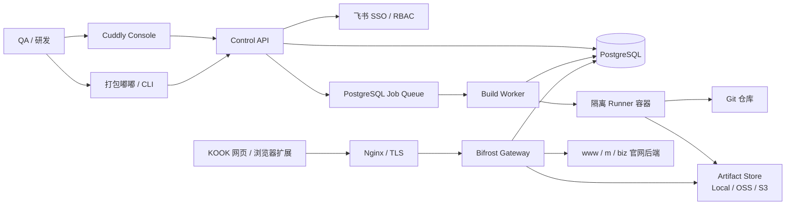
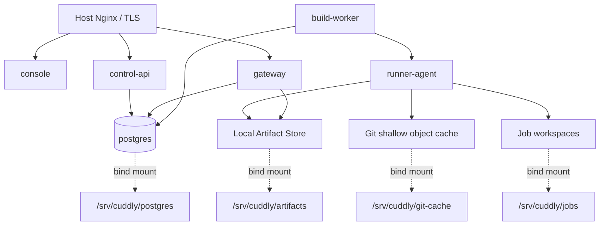
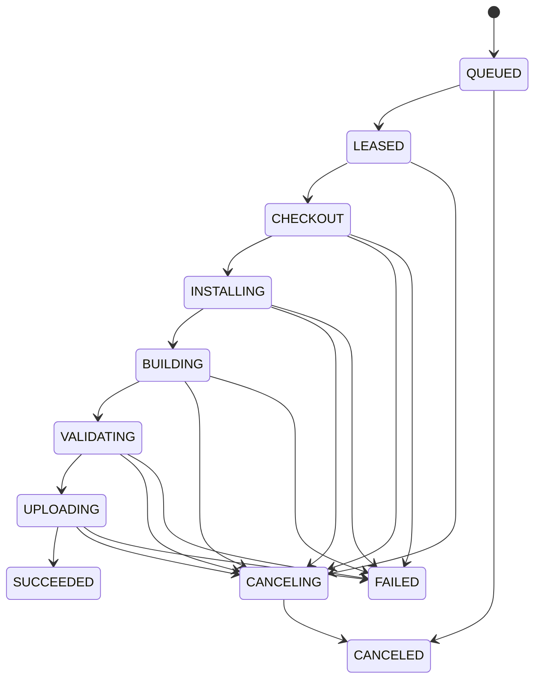
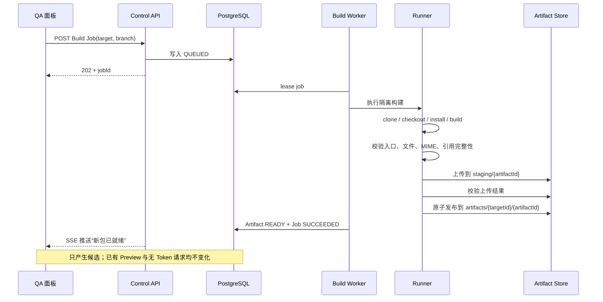
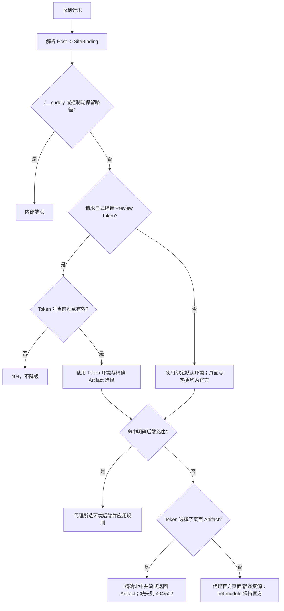

# Cuddly Web Artifact 与 Bifrost 网关系统设计

状态：Implemented v3  
日期：2026-08-26  
范围：打包模块、webapp / 在线 H5 / biz 前端制品、Bifrost 后端代理、标签页级 QA 预览

## 1. 结论与核心决策

本设计把“打包”“站点入口”和“某个标签页正在使用什么”彻底分开：

1. 构建任务只产生不可变 Artifact，不自动修改任何环境。
2. QA 面板和浏览器扩展展示各环境中每个项目、分支的最新候选 Artifact、打包时间和队列状态。
3. “某分支最新包”只表示候选 Artifact，不能作为运行时动态引用。
4. QA 在浏览器扩展中应用选择时，系统创建一个标签页级 Preview Session；Token 固定环境、页面
   Artifact 和 Remote Artifact，不改写任何公共环境。
5. SiteBinding 固定 hostname、站点形态、官方来源和无 Token 时的默认环境；有效 Preview Token
   可以在同一 hostname 上独立选择另一个 `ACTIVE` 或 `FROZEN`、未归档环境。
6. 无 Token 请求始终使用官方页面与官方 `hot-module`，后端请求走 SiteBinding 的默认环境；有效
   Token 才服务所选 Artifact 并让后端走 Token 环境。
7. 明确携带的 Token 若无效、过期或跨站点，Gateway 返回 `404`，绝不静默退回默认环境、官方页面
   或历史公共组合。
8. 在已选择页面 Artifact 的 Preview 内，缺失文件明确返回 404/502，防止一个页面混用两套前端。
9. QA 不需要看到 commit SHA。业务模型以目标、分支、打包时间和 Artifact ID 为准。
10. 首期 HTTP API 经过 Bifrost；Gateway WebSocket 和 RTC 继续使用官网返回的地址直连，后续再独立评估全代理。
11. 首个开发切片选择在线 H5，不以 biz 作为 PoC；biz 在 OAuth 回调、Cookie 和重定向链路完成专项验证后再接入。

## 2. 设计范围

### 2.1 本期包含

- `kook/apps/webapp` 的网页制品构建、保存、选择和服务。
- `html_h5` 在线 H5 的多入口制品构建、保存、选择和服务。
- `biz-fe` 的 SPA 制品构建、保存、选择和服务。
- Bifrost 已有官网 HTTP 代理、Cookie/Location 改写、接口覆盖规则的继承。
- Build Job、Artifact、Branch Catalog、Environment、SiteBinding、Preview Session 和配置组的控制面 API。
- QA 面板与浏览器扩展所需的查询、打包、队列、中断、选择、分享和标签页预览操作。
- 服务器本地文件 Artifact Store，以及后续可切换 OSS/S3 的存储接口。

### 2.2 本期不包含

- Electron 外壳和 PC 安装包构建。
- 替代 KOOK 后端。
- 通用 Mock 平台。
- 任意 JavaScript 代理规则编辑器。
- 首期代理 Gateway WebSocket、语音和 RTC 媒体流。
- 自动把某分支的新构建推到正在测试的环境。

### 2.3 已确认的实施约束

- 所有正式开发只发生在 `cuddly-umbrella` 目录内。
- 开始实现时把 `bifrost-kookapp` 和 `bifrost-frontend/bifrost-mis` 的必要代码迁入 Cuddly，之后不再把原 Bifrost 仓库作为运行时或发布依赖。
- 不修改、不提交、不推送原 Bifrost Git 远端。
- 业务源码仓库由 Runner 在构建任务中临时 clone。需要的构建适配存放在 Cuddly 内，不要求向业务仓库远端提交。
- Bifrost Gateway、Build Worker 和 Runner 首期部署在同一台服务器。
- 使用 Docker Compose 部署。
- Artifact 首期使用服务器本地磁盘，保留可切换 OSS/S3 的存储接口。
- PostgreSQL 由 Docker Compose 一并启动，不依赖服务器预装实例。
- Control API 接入飞书 OAuth；普通 QA 与配置功能都要求登录，操作人名称只取自飞书身份。首期不实现 RBAC。
- 开发过程中允许修改 Cuddly 内代码，但禁止向任何 Git 远端 push。

## 3. 关键语义

### 3.1 最新候选不等于已打开标签页正在使用

```text
feature/A 在 10:30 构建出 artifact-101
QA 在 10:40 应用选择，Preview Token 固定 artifact-101
feature/A 在 11:00 构建出 artifact-102

已打开的标签页仍然使用 artifact-101。
分支选择器显示最新候选 artifact-102。
QA 重新应用或再次打开配置分享时，新的 Preview 才会固定 artifact-102。
```

Preview Session 中只能存具体 `artifact_id`，禁止存 `branch = feature/A, use_latest = true` 一类动态
选择。配置组可以保存分支意图，但每次打开分享链接时必须先把分支解析为当前 READY Artifact，再创建
一份新的精确 Preview。

### 3.2 Preview 是标签页级完整快照

浏览器扩展可以先修改环境和多行项目选择，再一次创建 Preview。服务端在短事务中：

1. 校验 SiteBinding 存在且已启用。
2. 校验环境为 `ACTIVE` 或 `FROZEN`，且未归档。
3. 校验所有 Artifact 都为 `READY`，属于所选环境、正确项目与站点允许范围。
4. 创建包含环境、可选页面 Artifact 和 Remote Artifact 完整选择的 Preview Session。
5. 返回短期 Token，并写入审计事件。

网关只读取 Token 固定的选择，不会看到扩展 UI 中尚未应用的半套配置。公共 Environment Revision
发布已经退出人类操作协议：对应 POST 固定返回 `410 PUBLIC_REVISION_DISABLED`，遗留 Revision 表只
作兼容与审计，不再决定 Gateway 的运行时页面或热更。

## 4. 总体架构



### 4.1 进程边界

后端保持一个仓库，但按职责运行四个进程：

| 进程           | 职责                                                     | 是否直接执行构建命令 |
| -------------- | -------------------------------------------------------- | -------------------- |
| `control-api`  | 项目、构建、Environment、SiteBinding、Preview 与审计 API | 否                   |
| `build-worker` | 从 PostgreSQL 领取任务、调度 Runner、登记 Artifact       | 否                   |
| `runner-agent` | 在隔离目录或容器内 checkout、安装、构建、校验、上传      | 是                   |
| `gateway`      | 解析 SiteBinding/Preview、服务制品、代理后端与规则       | 否                   |

首期把 `control-api`、`build-worker`、`gateway` 和 `runner-agent` 部署在同一台服务器，但保持独立进程和容器。这样不需要跨机器传输源码、日志和 Artifact，也保留以后拆分 Runner 的能力。

### 4.2 Cuddly 单工作区结构

```text
cuddly-umbrella/
  apps/
    console/                    # 原 bifrost-mis 能力迁入这里
    control-api/
    gateway/                    # 原 bifrost-kookapp 代理能力迁入这里
    build-worker/
    runner-agent/
  packages/
    domain/
    db/
    contracts/
    artifact-store/
    build-adapters/
    site-adapters/
    bifrost-rules/
    observability/
  patches/
    html-h5/                    # 不推业务仓库的确定性构建适配
  deploy/
    nginx/
    docker/
  data/                         # 本地开发数据，生产使用 /srv/cuddly
  docker-compose.yml
  pnpm-workspace.yaml
```

前后端仍是独立应用和包，但统一放在一个 Git 工作区中开发和部署。原 Bifrost 代码迁入后按新模块边界整理，不保留“双仓同步”机制。

建议技术栈：

- 后端：Node.js 22 LTS、TypeScript、pnpm workspace。
- Control API：Fastify + Zod/OpenAPI。
- Gateway：Express 5 + `http-proxy-middleware`，优先复用现有 Bifrost 代码。
- 数据访问：PostgreSQL + Kysely，migration 进入后端仓库。
- 任务队列：首期 PostgreSQL `FOR UPDATE SKIP LOCKED` + lease。
- 前端：React + TypeScript + Vite + TanStack Query。
- 日志：Pino JSON 日志；构建日志单独持久化。
- 测试：Vitest、API 集成测试、Playwright。

### 4.3 单机 Docker Compose 拓扑



Compose 服务：

| 服务           | 说明                                    |
| -------------- | --------------------------------------- |
| `postgres`     | PostgreSQL 16，保存控制面数据和任务队列 |
| `control-api`  | QA API、Environment 和 Artifact 管理    |
| `gateway`      | Bifrost 网关和移动站数据面              |
| `build-worker` | PostgreSQL lease、任务状态和调度        |
| `runner-agent` | 首期单并发执行在线 H5 构建              |
| `console`      | QA 管理页面静态容器                     |

生产数据使用 `/srv/cuddly/*` bind mount，不把重要数据只留在容器可写层。`postgres` 和 Artifact 目录需要进入服务器备份计划。

## 5. 环境与域名模型

### 5.1 域名格式

生产环境使用 `*.bifrost.vanillacake.cn` 下的站点 hostname，域名只表达站点形态，不编码环境：

```text
main.bifrost.vanillacake.cn   # webapp
m.bifrost.vanillacake.cn      # online-h5
<site-id>.bifrost.vanillacake.cn
```

SiteBinding 保存 hostname、站点适配器、页面项目、官方页面来源、对应官网 Origin、允许的 Remote 和
资源代理白名单。绑定还保存一个默认环境，但它只决定无 Token 请求的后端 Base URL；浏览器标签页
实际预览哪个环境由 Preview Token 独立决定。这样同一个站点 hostname 可以同时承载多个互不干扰的
线上/测试环境标签页，也不需要为环境复制 DNS、证书或 SiteBinding。

### 5.2 Host 解析

Gateway 不依靠 Cookie 决定环境。请求先按 Host 解析 SiteBinding，再按是否携带 Token 形成上下文：

```ts
interface RequestSiteContext {
  siteBindingId: string
  hostname: string
  site: 'webapp' | 'online-h5' | 'biz'
  environmentId: string // Token 环境；无 Token 时为 binding.defaultEnvironmentId
  previewTokenId?: string
  siteArtifactId?: string
  remoteArtifactIds: Record<string, string>
}
```

请求行为固定为：

- 无 Token：官方页面、官方静态资源、官方完整 `hot-module`；后端走绑定默认环境。
- 有有效 Token：页面与 Remote 使用 Token 精确选择；未选择的部分仍为官方；后端走 Token 环境。
- Token 无效、过期或不属于当前 SiteBinding：返回 `404`，不执行 tokenless fallback。

因此不同环境可以在同一个浏览器中同时打开，Cuddly 的路由和 Artifact 不会因公共配置切换而互相
覆盖。

这里的“互不覆盖”只指 Cuddly 的路由与 Artifact 选择。浏览器仍按 origin 共享 Cookie、localStorage
和 Service Worker；同一 hostname 下的不同环境标签页不具备登录态隔离。若两个后端不应接收同一组
凭据，必须改用环境专属 hostname 或显式 Cookie 命名空间，不能把 Preview Token 当作浏览器存储
隔离机制。

## 6. 领域模型

### 6.1 Project

描述源码仓库和访问方式。

| 字段             | 说明                          |
| ---------------- | ----------------------------- |
| `id`             | 稳定 ID，例如 `kook-monorepo` |
| `name`           | 展示名称                      |
| `repository_url` | Git 地址                      |
| `default_branch` | 默认分支                      |
| `credential_ref` | 凭据引用，不保存明文私钥      |
| `enabled`        | 是否允许创建任务              |

### 6.2 Build Target

描述一个可独立构建和选择的目标。

| 字段          | 说明                                               |
| ------------- | -------------------------------------------------- |
| `id`          | `webapp`、`online-h5`、`biz`，未来可扩展 `base` 等 |
| `project_id`  | 所属 Project                                       |
| `kind`        | `webapp`、`h5-site`、`spa-site`、`remote`          |
| `adapter_key` | 构建适配器                                         |
| `required`    | 遗留兼容字段；标签页 Preview 不使用“发布必选”语义  |
| `enabled`     | 是否允许构建和选择                                 |

Build Target 配置由 Cuddly 管理，不要求写入业务仓库。

### 6.3 Build Job

一次明确的构建请求。

| 字段                                        | 说明                                           |
| ------------------------------------------- | ---------------------------------------------- |
| `id`                                        | UUID/ULID，同时可作为 Artifact ID 的预分配来源 |
| `target_id`                                 | 构建目标                                       |
| `branch`                                    | 用户选择的分支标签                             |
| `profile`                                   | `qa-web` 等构建 profile                        |
| `status`                                    | 任务状态                                       |
| `requested_by`                              | 发起人                                         |
| `idempotency_key`                           | 防止按钮重试重复创建                           |
| `created_at` / `started_at` / `finished_at` | 时间                                           |
| `failure_code` / `failure_message`          | 结构化失败原因                                 |
| `log_uri`                                   | 完整日志地址                                   |

状态机：



### 6.4 Artifact

Artifact 是构建成功后登记的不可变制品。

| 字段                  | 说明                                                     |
| --------------------- | -------------------------------------------------------- |
| `id`                  | 稳定 Artifact ID                                         |
| `build_job_id`        | 来源任务，唯一                                           |
| `target_id`           | 所属 Build Target                                        |
| `branch`              | QA 展示用分支标签                                        |
| `status`              | `STAGING`、`READY`、`QUARANTINED`、`DELETING`、`DELETED` |
| `storage_key`         | 对象存储根路径                                           |
| `manifest`            | 服务入口、文件清单、MIME、大小和摘要                     |
| `built_at`            | 打包完成时间                                             |
| `created_by`          | 发起人                                                   |
| `deletion_started_at` | 进入两阶段回收的时间                                     |

环境只能引用 `READY` Artifact。Artifact 一旦 `READY`，文件和 manifest 都不能原地覆盖。

### 6.5 Branch Build Catalog

Catalog 不需要独立真相表，可以由 Git 分支列表、Build Job 和 Artifact 聚合得到：

```text
target + branch
  分支是否存在
  是否正在构建
  最近一次任务状态
  最近一次成功 Artifact
  最近一次成功打包时间
```

分支的“最近成功 Artifact”只用于专用分支选择器和“有新包可用”提示。选择器支持搜索，按最近构建
活动排序，并把全局队列中的实时阶段和排队位置叠加到对应分支；队列轮询不重复查询 Git。

### 6.6 Environment

| 字段                  | 说明                                           |
| --------------------- | ---------------------------------------------- |
| `id` / `slug`         | 稳定环境标识                                   |
| `name`                | QA 展示名称                                    |
| `backend_origin`      | 不带 `/api` 的后端 Base URL                    |
| `use_internal_proxy`  | 业务后端是否经内置 Mihomo；默认 `false`        |
| `status`              | `ACTIVE`、`FROZEN`、`ARCHIVED`                 |
| `current_revision_id` | 遗留兼容字段；生产运行时应为空，Gateway 不读取 |
| `created_by`          | 创建人                                         |

`ACTIVE` 环境允许构建和创建 Preview；`FROZEN` 环境拒绝新构建，但允许用现有 READY Artifact 创建
Preview；`ARCHIVED` 环境从普通入口隐藏，并拒绝新的 Preview。

`use_internal_proxy=true` 只作用于当前环境的 Backend Origin，包括普通业务接口和 `hot-module`；
SiteBinding 的页面回退源与资源代理不经过该链路。Gateway 使用显式的内部 HTTP 代理地址建立连接，
未配置或 Mihomo 不可达时失败关闭，不允许绕过代理直连目标后端。

### 6.7 Preview Session

Preview Session 是单个浏览器标签页配置的不可变快照：

```text
Preview Session
  token_hash   -> ...
  site_binding -> main
  environment  -> staging
  siteArtifact -> artifact-webapp-101 | null（官网页面）
  remotes.base -> artifact-base-1842 | omitted（官方热更）
  expires_at   -> ...
```

Token 保存精确 Artifact ID，不保存动态 `latest` 引用。环境与 SiteBinding 默认环境可以不同，但所有
Artifact 必须属于 Token 环境。`siteArtifact` 和 Remote 选择都可以为空；全为空时仍创建真实的
“仅切换后端环境”Preview，让刷新、分享与其它组合使用相同的 Token 校验语义。

### 6.8 遗留 Environment Revision

`environment_revisions`、`environment_revision_items`、`environment_artifact_refs` 与
`environments.current_revision_id` 暂时保留，避免升级时破坏历史数据库和审计记录。它们不再是运行时
真相：

- Gateway 无 Token 时不读取 `current_revision_id`，而是服务官方页面/官方热更。
- 人类调用 `POST /api/v1/environments/{environmentId}/revisions` 固定得到
  `410 PUBLIC_REVISION_DISABLED`。
- Console 不展示暂存、使用当前包、发布或回滚公共 Revision 的入口。
- 历史 Revision 引用不构成 Artifact 文件保留或可回滚承诺。

## 7. Artifact Manifest

manifest 由 Runner 在构建后扫描输出目录生成，不能只信任项目自身生成的 manifest。

```json
{
  "schemaVersion": 1,
  "artifactId": "01JWEBAPP101",
  "target": "webapp",
  "branch": "feature/A_1",
  "builtAt": "2026-08-11T14:30:00+08:00",
  "serve": {
    "siteAdapter": "kook-webapp-v1",
    "entrypoints": [
      "index.htm",
      "activity.htm",
      "browser.htm",
      "picture.htm",
      "widget.htm",
      "toolbar.htm",
      "countdown.htm",
      "private_voice.htm",
      "exp/index.htm",
      "exp/qh.htm"
    ],
    "publicBase": "/__cuddly/artifacts/01JWEBAPP101/app/"
  },
  "files": [
    {
      "path": "index.htm",
      "size": 18342,
      "contentType": "text/html; charset=utf-8",
      "digest": "sha256:...",
      "cacheClass": "html"
    },
    {
      "path": "static/js/main.a1b2c3d4.js",
      "size": 940123,
      "contentType": "text/javascript; charset=utf-8",
      "digest": "sha256:...",
      "cacheClass": "immutable"
    }
  ]
}
```

摘要只用于完整性校验、ETag 和去重，不向 QA 展示，也不等同于 Git commit SHA。

## 8. 构建与预览流水线



### 8.1 源码隔离

禁止在共享 clone 中切分支，也不使用 Git worktree。

Runner 维护持久的 shallow bare 对象缓存，每个 Job 创建一次性独立 clone：

```text
/srv/cuddly/git-cache/v1/repositories/<hmac>.git # 按仓库与凭据隔离，只做浅 fetch
/srv/cuddly/runner-jobs/<jobId>/source           # 一次性 depth-1 clone
```

缓存键为设置密钥对“仓库地址 + HTTP 认证头或 SSH 身份指纹”的 HMAC，不在磁盘路径中暴露仓库或
凭据。每次 checkout 都先强制 fetch 所选远端分支，成功解析本次 commit 后才从缓存通过本机 Git
传输物化工作目录；远端失败时不读取已有 tip。工作目录恢复真实分支、`origin` 和 upstream，且不含
alternates，所以缓存清理不会破坏正在运行的 Job。

同一缓存键的初始化、fetch 与对象复制由进程内锁和文件锁串行化；复制完成后立即释放仓库锁，
checkout、Git LFS、依赖安装和构建继续在各自 Job 中并行。不同缓存键从一开始即可并行。fetch 前
清除缓存中的旧 tag 引用，再由本次远端 fetch 恢复当前分支可达的 tag，避免删除或移动过的 tag
泄漏到新工作目录。

只有缓存自身明确不可用时，Runner 才删除未完成目录并重试原有的远端
`--depth 1 --single-branch` clone；远端网络、鉴权、分支、磁盘压力和未知 I/O 错误不回退，避免
重复下载、陈旧结果和容量保护绕过。缓存默认采用 14 天 LRU、1 GiB 目标软上限、4 GiB 清理水位
和 2 GiB 拒绝水位；缓存物化与直接 clone 共用容量预留。当前部署约束为一个 Runner 实例，文件锁
负责异常恢复与未来多进程冲突保护，但不将其视为完整的跨实例调度协议。

任务结束后删除 Job 目录。不同任务之间不共享工作目录、`node_modules` 或构建输出。依赖下载缓存
使用包管理器缓存目录，不复用源码目录。

### 8.2 Runner 安全边界

- 每个任务运行在独立容器中。
- 仓库凭据只在 checkout 阶段短期挂载，构建阶段尽可能移除。
- CPU、内存、磁盘和最大运行时间均有限额。
- 默认禁止访问 Docker Socket。
- 构建网络按 Project/Target allowlist 配置。
- 分支名只作为 Git 参数，不拼接到 shell 命令或存储路径。
- Artifact 存储路径使用内部 ID，不使用原始分支名。

### 8.3 Build Adapter

```ts
interface BuildAdapter {
  key: string
  checkout: {
    projectId: string
    workdir: string
  }
  runtime: {
    image: string
    cpu: number
    memoryMb: number
    timeoutSeconds: number
  }
  build: {
    install: string[]
    commands: string[]
    outputDir: string
    env: Record<string, string>
  }
  validation: ArtifactValidationSpec
  siteAdapter: string
}
```

首批适配器：

| Target      | workdir       | 构建命令                     | 输出     | 关键校验                                              |
| ----------- | ------------- | ---------------------------- | -------- | ----------------------------------------------------- |
| `webapp`    | `apps/webapp` | `npm run build:ttt:nosource` | `build/` | `index.htm`、全部入口、`static/`、动态 chunk 引用     |
| `online-h5` | 仓库根        | `pnpm run build`             | `build/` | 五个 `.htm` 入口、manifest 全文件、`public/` 复制结果 |
| `biz`       | 仓库根        | `npm run build`              | `build/` | `index.html`、`static/`、`statics/`                   |

### 8.4 Artifact 专属资源前缀

某分支的新包 READY 后，已经打开的旧 Preview 页面仍可能继续加载旧包异步 chunk。若所有资源都使用
`/static/*`，旧页面会从新候选对应的可变位置查旧 chunk，产生 404。

因此每次构建在开始前预分配 Artifact ID，并把资源 public path 设置为不可变路径：

```text
/__cuddly/artifacts/<artifactId>/app/      # webapp
/__cuddly/artifacts/<artifactId>/          # online-h5
/__cuddly/artifacts/<artifactId>/          # biz
```

具体处理：

- webapp 已支持 `PUB_PATH`，构建时传入 Artifact 专属 `/app/` 前缀。
- biz 已支持 `PUB_PATH`，直接传入 Artifact 专属前缀。
- online H5 当前固定 `/` 的 `assetPrefix` 由 Cuddly Build Adapter 在临时 clone 中应用确定性补丁，使其允许构建环境变量覆盖。补丁保存在 `patches/html-h5/`，不推送业务仓库远端。
- HTML 入口仍通过 SiteBinding hostname 的正常路径访问，但 HTML 内的 JS/CSS 和动态 chunk 都指向
  Artifact 专属路径。

Artifact ID 隔离可避免新旧 Preview 混用文件。有效 Preview 精确引用的旧包不会被回收；Token 撤销
或到期且旧包已经退出该环境/项目/分支的最新候选槽位后，保留任务可以删除其文件，因此 Preview
到期后的历史页面不提供异步 chunk 可用保证。

## 9. Artifact 存储

### 9.1 存储接口

```ts
interface ArtifactStore {
  putStaging(artifactId: string, files: AsyncIterable<ArtifactFile>): Promise<void>
  verifyStaging(artifactId: string, manifest: ArtifactManifest): Promise<void>
  publish(targetId: string, artifactId: string): Promise<string>
  open(storageKey: string, path: string, range?: ByteRange): Promise<ArtifactObject>
  delete(storageKey: string): Promise<void>
}
```

实现：

- 首期开发和正式部署：服务器本地文件系统，根目录 `/srv/cuddly/artifacts`。临时目录完成后通过同文件系统 rename 原子发布。
- 后续扩展：阿里云 OSS 或 S3 兼容存储。ArtifactStore 接口从第一天保留，但首期不部署对象存储依赖。

本地磁盘目录：

```text
/srv/cuddly/artifacts/staging/<artifactId>/
/srv/cuddly/artifacts/ready/<targetId>/<artifactId>/
/srv/cuddly/build-logs/<yyyy>/<mm>/<jobId>.log
```

`staging` 和 `ready` 必须位于同一文件系统，确保 rename 原子性。Gateway 只读取 `ready`，并且仍以数据库 `Artifact.status = READY` 作为可见条件。

### 9.2 存储键

```text
artifacts/<targetId>/<artifactId>/manifest.json
artifacts/<targetId>/<artifactId>/files/...
build-logs/<yyyy>/<mm>/<jobId>.log
```

不创建 `latest/` 可变目录，也不让 Gateway 按 `branch/latest` 取运行时文件。

### 9.3 保留策略

- 每个 `environment + target + branch` 只有一个最新 READY 候选槽位。
- 新包构建与校验期间旧候选继续可用；新包 READY 后才替换该槽位并尝试删除旧包，失败构建不影响
  旧候选。
- 尚未过期的 Preview 精确引用会暂时阻止旧包删除；Token 撤销或到期后，Worker 启动时及运行期间
  每分钟 sweep 重新回收。因此正常目录只保留一个候选，已有测试会话又不会在构建完成时断裂。
- 历史 Revision 只保留 Artifact ID、分支和时间等轻量审计信息，不作为文件保留依据。
- 删除采用两阶段流程：数据库原子标记 `DELETING`，Runner 校验精确 storage key 后把目录原子移动
  到同文件系统回收区、完成物理删除，最后记录 `DELETED` tombstone。请求超时、断网或 5xx 的结果
  均视为不确定并保持 `DELETING`，5 分钟后幂等重试；绝不让 READY 指向可能已删或残缺的目录。
- 构建失败会清理 staging；Worker 还会定期核对 Runner 磁盘清单，超过安全宽限期且数据库无记录的
  orphan 目录也会进入同一幂等删除链路，避免异常或崩溃绕过单槽上限。
- Preview 创建与候选标记共用短事务锁，并在事务内复验 READY，避免引用刚被选中删除的旧包。

## 10. Bifrost Gateway 设计

### 10.1 请求处理顺序



### 10.2 路由判定接口

```ts
interface SiteAdapter {
  id: string
  site: 'webapp' | 'online-h5' | 'biz'
  upstream: URL

  isBackendRequest(req: Request): boolean
  resolveArtifactFile(req: Request, manifest: ArtifactManifest): ArtifactFileMatch | null
  isExpectedStaticPath(req: Request): boolean
  resolveNavigationEntry(req: Request, manifest: ArtifactManifest): string | null

  rewriteProxyRequest(req: Request): void
  proxyRules: ProxyRule[]
}
```

判定原则：

1. `POST/PUT/PATCH/DELETE` 默认视为后端请求，内部控制路径除外。
2. 已知 `/api/`、`/mis/` 等前缀优先代理。
3. Artifact 文件必须通过 manifest 精确命中，禁止直接拼接磁盘路径。
4. 带静态扩展名或位于静态命名空间的请求，找不到文件就返回 404。
5. HTML fallback 只接受 `GET/HEAD` 且请求是浏览器导航。
6. 非导航 XHR/fetch 可以作为上游应用请求代理，但必须记录未登记路由指标，逐步收敛 allowlist。

### 10.3 静态响应链

静态制品不经过现有 `responseInterceptor`：

- HTML 由轻量 `HtmlShellRenderer` 读取并注入环境 bootstrap，然后返回。
- JS/CSS/字体/图片直接从 Artifact Store 流式返回。
- 支持 `HEAD`、`Range`、`If-None-Match` 和正确 MIME。
- 对象存储异常返回明确的 502，不回退官网静态文件。

Artifact 专属 URL 的授权规则：

1. 先根据 Host 确认 SiteBinding，再校验请求的 Preview Token 属于该绑定且仍有效。
2. URL 中的 Artifact ID 必须被该 Token 精确选择，并属于 Token 环境与正确项目。
3. Artifact 还必须为 READY；有效 Preview 引用会阻止其进入删除流程。
4. 仅存在于 Branch Catalog、没有被当前 Token 选择的候选 Artifact 不可读取。
5. 无 Token 请求没有 Artifact 读取权，只代理官方页面与官方热更。
6. 历史 Revision 不授予 Artifact 读取权；Artifact 若已标记 DELETED，即使 ID 仍在审计记录中也不可读。

缓存策略：

| 类型                            | Cache-Control                         |
| ------------------------------- | ------------------------------------- |
| 环境入口 HTML                   | `no-cache, must-revalidate`           |
| Artifact 专属且带 hash 的文件   | `public, max-age=31536000, immutable` |
| Artifact 专属但不带 hash 的文件 | `public, max-age=86400`               |
| `/__cuddly/runtime`             | `no-store`                            |
| API 代理响应                    | 保留上游语义，覆盖规则另行决定        |

### 10.4 HTML bootstrap

Gateway 只改写入口 HTML，不改写普通 JS/CSS：

```html
<script src="/__cuddly/bootstrap.js"></script>
<script src="/__cuddly/hooks/k-inject-12.js"></script>
```

`bootstrap.js` 返回当前 Environment、SiteBinding、Preview 和 Artifact，并设置 `window.__CUDDLY__`。
它使用 `no-store`，实际输出必须用安全 JSON 序列化并转义 `<`。采用同源外部脚本而不是内联脚本，
便于收紧 CSP。

Gateway 以同源、版本化路径服务审核过的 `k-inject` 文件，避免页面依赖管理端跨域地址。Hook 加载
失败不能阻塞主页面。Gateway 配置中记录 hook 版本，便于回滚和审计。

### 10.5 后端代理链

继续复用 Bifrost 的：

- `changeOrigin`。
- Cookie Domain 改写。
- 3xx Location 改写。
- 接口 JSON 覆盖。
- CDN/站点绝对 URL 改写。

但响应处理需要从“所有文本响应完整缓冲”演进为：

```text
请求是否可能命中响应规则？
  是 -> 限制最大响应大小，缓冲并改写
  否 -> 原生流式 proxy.pipe(res)
```

这样下载、长响应和普通 API 不承担无意义的缓冲成本。

## 11. 三站点路由适配

### 11.1 webapp

Artifact 根目录是 `apps/webapp/build`。

| 请求               | Artifact 映射                         |
| ------------------ | ------------------------------------- |
| `/`                | `index.htm`                           |
| `/app/<file>`      | `<file>`                              |
| `/app/<spa-route>` | `index.htm`，仅 HTML 导航             |
| `/exp/<file>`      | `exp/<file>`                          |
| `/exp/<route>`     | `exp/index.htm`，仅 HTML 导航         |
| `/widget`          | `widget.htm`                          |
| `/api/*`           | 代理当前请求有效环境的 Backend Origin |

必须校验全部 Rspack HTML 入口。`/app/static/*` 请求在 Artifact 中映射到 `static/*`。

Module Federation：

- Preview Token 选中的 webapp Artifact 使用 Artifact 专属 public path；无 Token 时代理官方页面。
- Remote 由 `hot-module` 完整响应叠加映射，并使用 Preview 专属不可变 URL 规范。
- 首期网页 shell 已加载 bootstrap，因此 Artifact 自身的普通 chunk 不再走 `remoteEntryInject`。
- 从官网 CDN 镜像回来的 Remote 继续保留现有注入规则，直到浏览器扩展或统一 bootstrap 完全接管。

### 11.2 在线 H5

Artifact 根目录是 `html_h5/build`。

正式入口：

```text
index.htm
topup.htm
gift-gacha.htm
card-collect.htm
ratings-preview.htm
```

路由规则：

- 精确命中任意 Artifact 文件时直接返回。
- 上述入口路径精确映射对应 HTML。
- 主站未知导航路径 fallback 到 `index.htm`。
- `/api/*` 和非导航应用请求代理当前请求有效环境的 Backend Origin。
- `/app/*` 保留当前移动站跳转语义，是否 301 由 Site Adapter 明确实现。

校验必须检查：

- 五个正式入口全部存在。
- Runner 生成的 manifest 中每个文件都存在且大小大于零。
- HTML 引用的本地 JS/CSS/字体存在。
- `public/` 中需要上线的历史页面和 SDK 被完整复制。
- HTTPS 页面不包含会触发混合内容的关键 HTTP 资源。

在线 H5 是首个 PoC 目标。它具备多入口和历史静态资源，足以验证 Artifact 完整性、资源路径、HTML
fallback、API 代理、Cookie 和标签页 Preview，同时不需要先处理 biz OAuth 的额外不确定性。

### 11.3 biz

Artifact 根目录是 `biz-fe/build`。

| 请求             | 处理                                                                  |
| ---------------- | --------------------------------------------------------------------- |
| `/api/*`         | 代理当前请求有效环境的 Backend Origin                                 |
| `/mis/*`         | 代理当前请求有效环境的 Backend Origin；需要拆分时由 Site Adapter 明确 |
| 精确静态文件     | 返回 Artifact 文件                                                    |
| 其它 HTML 导航   | `index.html`                                                          |
| 找不到的静态路径 | 404                                                                   |

biz 不作为首个 PoC。接入前需要先完成 OAuth 专项验证：

- 登录入口和真正的授权服务域名。
- `redirect_uri`、`state`、PKCE 或其它防重放参数。
- OAuth 回调落在哪个 Host 和路径。
- 302 Location 是否会跳回官网域名。
- 登录 Cookie 的 Domain、SameSite、Secure 和跨站行为。
- `/api`、`/mis` 是否实际由同一 upstream 处理。

这些信息收敛后再决定 Site Adapter 的 OAuth 路由是透明代理、回调域名改写，还是使用独立认证 upstream。

## 12. Control API

创建构建等可重试写 API 接受 `Idempotency-Key`。Preview 创建使用精确 Artifact ID，并在服务端再次
校验 SiteBinding、环境和 READY 状态。

### 12.1 分支与候选制品

```http
GET /api/v1/build-targets/{targetId}/branches?query=feature%2FA
```

```json
{
  "items": [
    {
      "branch": "feature/A_1",
      "buildStatus": "IDLE",
      "latestArtifact": {
        "id": "artifact-webapp-102",
        "builtAt": "2026-08-11T11:00:00+08:00"
      }
    },
    {
      "branch": "feature/A_2",
      "buildStatus": "IDLE",
      "latestArtifact": null
    }
  ]
}
```

### 12.2 发起构建

```http
POST /api/v1/build-jobs
Idempotency-Key: 4ecb...
Content-Type: application/json

{
  "targetId": "webapp",
  "branch": "feature/A_1",
  "profile": "qa-web"
}
```

返回 `202 Accepted` 和 `jobId`。重复幂等键返回同一个 Job。

运行中或排队任务可由构建记录详情中断：

```http
POST /api/v1/build-jobs/{jobId}/cancel
```

排队任务原子进入 `CANCELED`；运行任务原子进入 `CANCELING`，Runner 终止完整命令进程组且执行器
真正退出后才进入 `CANCELED`。同一项目在 `CANCELING` 期间仍保持占用，避免新旧构建并行写入。

### 12.3 构建状态与日志

```text
GET /api/v1/build-jobs/{jobId}
GET /api/v1/build-jobs/{jobId}/events     # SSE
POST /api/v1/build-jobs/{jobId}/cancel
```

SSE 只推送状态和增量日志位置；完整日志由分页接口或对象存储读取，避免连接重放超大日志。

### 12.4 环境候选矩阵

```http
GET /api/v1/environments/{environmentId}/matrix
```

每行返回：

- target/package。
- 所选环境中各分支最近成功的 READY Artifact 与打包时间。
- 浏览器扩展当前编辑的分支，以及当前标签页 Token 已固定的 Artifact。
- 该分支是否已具备可应用的候选。
- 当前构建任务。

这里不存在“公共环境当前 Artifact”。无 Token 的公共站点始终是官方页面与官方热更；表格展示的是
候选与某个标签页的已应用快照，不能把构建历史或旧 Revision 当成运行时真相。

### 12.5 创建标签页 Preview

浏览器扩展在本地编辑环境与多行选择，最终提交精确组合：

```http
POST /api/v1/previews
Idempotency-Key: 93a2...
Content-Type: application/json

{
  "siteBindingId": "main",
  "environmentSlug": "staging",
  "siteArtifactId": "artifact-webapp-102",
  "ttlMinutes": 480,
  "selections": [
    { "targetId": "base", "artifactId": "artifact-base-205" },
    { "targetId": "discover", "artifactId": "artifact-discover-088" }
  ]
}
```

`siteArtifactId` 和 `selections` 都可以省略；此时仍创建环境级 Preview Token，页面与热更保持官方，
后端走 `environmentSlug` 对应 Base URL。创建成功后扩展把 Token 只附加到目标标签页，并导航到
SiteBinding hostname。明确携带的 Token 无效、过期或跨站点时，Gateway 返回 `404`。

### 12.6 公共 Revision API 退役

```http
POST /api/v1/environments/{environmentId}/revisions
-> 410 PUBLIC_REVISION_DISABLED
```

Console 不提供“使用此包”“发布”或回滚公共 Revision 的 UI。撤销一个标签页组合使用
`DELETE /api/v1/previews/{token}`；重新应用分支会创建新 Token，不会改写旧 Preview。

## 13. 数据库表与约束

核心表：

```text
projects
build_targets
build_jobs
build_job_events
artifacts
environments
environment_project_configs
site_bindings
preview_sessions
configuration_groups
environment_revisions
environment_revision_items
environment_artifact_refs
proxy_rule_sets
audit_events
idempotency_records
```

关键约束：

- `artifacts.build_job_id` 唯一。
- `site_bindings.hostname` 唯一。
- Preview 的环境 ID/slug 必须引用同一条 Environment；SiteBinding 与 Preview 环境不要求相同。
- Preview 的页面与 Remote Artifact 必须为 READY、属于 Preview 环境，并落在 SiteBinding 允许范围内。
- 配置组固定环境、SiteBinding 与站点全部项目的 official/branch 意图；打开时解析为新的精确 Preview。
- `environment_revisions(environment_id, revision_no)` 唯一。
- `environment_revision_items(revision_id, target_id)` 唯一。
- `environment_artifact_refs(environment_id, artifact_id)` 唯一。
- Revision 相关约束只用于遗留数据一致性，不授予运行时读取权，也不阻止文件回收。

Preview 创建事务伪代码：

```sql
BEGIN;
SELECT id, slug, status FROM environments WHERE slug = $1;
SELECT id, enabled, target_id, remote_target_ids FROM site_bindings WHERE id = $2;
-- 校验环境未归档、绑定启用、Artifact READY/环境/target/站点范围全部匹配
INSERT INTO preview_sessions (...精确环境、站点与 Artifact 选择...);
INSERT INTO audit_events (...);
COMMIT;
```

## 14. QA 面板契约

浏览器扩展必须直接展示当前编辑环境和各项目选择，不以操作历史代替：

| 包/站点 | 当前编辑分支  | 最新 READY 包 | 标签页已应用 | 状态/操作           |
| ------- | ------------- | ------------- | ------------ | ------------------- |
| webapp  | `feature/A_1` | 11:00         | 10:30 的包   | 可应用 / `打最新包` |
| base    | `feature/A_1` | 暂无          | 官方热更     | 构建中 / 查看队列   |
| gift    | 官方热更      | —             | 官方热更     | 就绪                |

交互规则：

1. 环境选择器独立于站点，支持同一个站点在 `ACTIVE`/`FROZEN` 非归档环境间切换；选择实时持久化。
2. 在专用分支选择器中切换分支只是编辑当前标签页意图，不改变已应用 Preview。
3. `打最新包` 只创建 Build Job；完成后显示新候选，不改变任何标签页。
4. 任一已选分支没有 READY Artifact 时，“应用”禁用并说明原因。
5. “应用”创建一份完整 Preview，并只更新当前标签页；没有公共“发布”按钮。
6. 配置分享保存环境和站点全部项目分支；每次打开短链解析最新 READY 包并创建新的 Preview。
7. 每行可查看 Artifact 历史与队列，SHA 不出现在默认页面。

## 15. 身份、权限与 Cookie

### 15.1 角色

| 角色      | 权限                                       |
| --------- | ------------------------------------------ |
| Viewer    | 查看环境、候选、构建状态和日志             |
| QA        | 创建构建、标签页 Preview 与配置分享        |
| Developer | QA 权限 + 管理自己负责的 Build Target 配置 |
| Admin     | 管理项目、Runner、规则集、权限和保留策略   |

当前已接入飞书登录，但暂不实现完整 RBAC。所有成功登录且位于飞书应用可用范围内的用户拥有相同
能力，可以查看、构建、创建/撤销标签页 Preview、分享配置并维护项目配置。操作人名称从飞书身份
读取，用于队列展示和审计；控制台与浏览器扩展都不接受自定义操作人名称。Viewer、QA、Developer
和 Admin 仍是后续角色模型。

### 15.2 飞书登录

飞书登录只承担控制面鉴权与操作人识别，不改变 Build、Artifact、Preview 或 Gateway 数据面协议：

- 固定使用 Authorization Code + PKCE S256，公开回调为
  `https://bifrost.vanillacake.cn/api/v1/auth/feishu/callback`；其它部署通过
  `CUDDLY_PUBLIC_ORIGIN` 生成相同路径，并必须登记到飞书白名单。
- OAuth `state`、PKCE verifier 和安全的站内返回路径保存在 10 分钟有效的
  `Secure`、`HttpOnly`、`SameSite=Lax` 回调路径 Cookie 中，回调消费后立即清除。
- 飞书 `app_id` 与 `app_secret` 只从 `/srv/cuddly/secrets/feishu/` 下的 0600 Secret 文件读取，
  不进入环境变量、数据库、仓库、镜像或前端。飞书 access token 只用于服务端读取身份，随后丢弃。
- Cuddly 自行生成 7 天有效的随机会话令牌，数据库只保存令牌摘要；Host-only 管理 Cookie 使用
  `Secure`、`HttpOnly`、`SameSite=Lax`，不共享给预览子域。
- 面向用户的 Control API 要求有效会话，非只读请求还要求会话绑定的 CSRF Token；健康检查保持公开，
  `/api/v1/internal/*` 继续使用独立 Bearer Token，Gateway 不接收管理会话。
- 会话以飞书 tenant key 与 open ID 标识主体，以飞书姓名展示操作人。客户端自报操作人请求头、匿名
  队列标识和自定义显示名全部退出生产协议。
- 首期没有角色划分或额外 tenant allowlist，部署者必须把飞书应用可用范围限制在允许操作 Cuddly 的
  公司成员内；后续 RBAC 只扩展授权判断，不改变既有业务 API。

### 15.3 业务站 Cookie

Cuddly 管理会话 Cookie 只属于控制台 Host，绝不下发到预览子域，也不由 Gateway 转发给 KOOK 上游。
KOOK 业务 Cookie 与管理会话相互独立，仍由 Gateway 按业务代理规则处理。

预览域名下如需跨站点共享 KOOK 业务 Cookie，应统一改写到 `.bifrost.vanillacake.cn`。必须保留
`Secure`、`HttpOnly` 和合理的 `SameSite`，并用真实登录流程测试，而不是只看响应头。

## 16. 一致性、缓存与故障处理

### 16.1 SiteBinding 与 Preview 缓存

Gateway 缓存 `hostname -> SiteBinding` 和有效 `token -> Preview Session`。Token 撤销或过期后，新请求
立即按协议拒绝；实现允许短期正缓存，但必须为 Artifact 回收设置覆盖该 TTL 的保护窗。无 Token
请求不读取 `current_revision_id`，因此不存在公共发布后的缓存失效问题。

Preview 入口 HTML 返回可诊断的 Preview、Environment 和 Artifact 标识，便于定位 QA 截图对应版本；
不得暴露原始 Token。

### 16.2 故障策略

| 故障                      | 行为                                                        |
| ------------------------- | ----------------------------------------------------------- |
| Preview Artifact 文件缺失 | 404/502 + 结构化日志，绝不回退官网前端                      |
| Artifact Store 暂时不可用 | 502，可由 Nginx 短时缓存已有静态对象                        |
| PostgreSQL 暂时不可用     | 控制面写操作失败关闭；不得把显式 Token 当成无 Token 处理    |
| Token 无效/过期/跨站点    | 404，绝不回退 SiteBinding 默认环境或官方页面                |
| Build Worker 宕机         | lease 超时后任务重新入队；Runner 操作必须幂等               |
| 构建成功但 DB 未登记      | staging 内容由清理任务回收，不对环境可见                    |
| DB 已 READY 但对象缺失    | 健康检查将 Artifact 标记 `QUARANTINED`，禁止新 Preview 引用 |
| 上游 API 超时             | 返回明确 502/504，记录 site/environment/upstream            |

### 16.3 不允许的降级

- 不允许从 Artifact 页面静默切回官网 HTML。
- 不允许找不到当前 Artifact 时自动改用该分支最新 Artifact。
- 不允许显式 Token 校验失败后进入 tokenless fallback。
- 不允许部分 Preview 选择成功、部分失败。
- 不允许 Build Job 成功后自动创建或替换 Preview。

## 17. 可观测性与诊断

每个请求日志至少包含：

```text
request_id
environment_id
site_binding_id
preview_id（有 Token 时）
artifact_id（静态请求）
upstream（代理请求）
route_decision
status
duration_ms
response_bytes
```

诊断端点：

```text
GET /__cuddly/whoami
GET /__cuddly/runtime
GET /__cuddly/health/live
GET /__cuddly/health/ready
```

`whoami` 返回收到的 Host、绑定、有效环境、Preview、当前 Artifact 和最终路由判断，不返回 Token、
凭据或完整 Cookie。

关键指标：

- Build Job 排队时间、构建时间、成功率、失败阶段。
- Artifact 上传时间、校验失败次数、存储字节数。
- Gateway 静态命中率、Artifact 404、上游代理延迟和 5xx。
- Preview 创建、撤销、过期、无效与跨站点 Token 次数。
- 未登记但被代理的应用路径，用于收敛 backend allowlist。

## 18. 测试策略

### 18.1 单元测试

- Site Adapter 路径映射和导航判定。
- manifest 生成和路径穿越防护。
- Branch Catalog 最新候选计算。
- Preview 的 SiteBinding、环境、Artifact target 与允许范围匹配。
- Cookie Domain、Location 和文本 URL 改写。

### 18.2 集成测试

- 使用临时 PostgreSQL、MinIO 和假上游服务跑完整 Control API/Gateway。
- 构建成功后只产生 Artifact，不改变 Environment。
- 多项选择一次创建 Preview 且不存在半应用状态。
- 新包成功后，旧 Preview 仍能加载其精确 Artifact 异步 chunk。
- 同一 SiteBinding 可分别使用默认环境和 Token 选择的其它非归档环境。
- 无 Token 始终使用官方页面/官方热更；无效、过期或跨站点 Token 返回 404 且不降级。
- Artifact 缺文件时不会请求官网同名静态文件。

### 18.3 真实链路 E2E

- 飞书登录、回调 state/PKCE、会话过期与退出登录；控制台和扩展跨 Origin 会话、CSRF 及操作人展示。
- KOOK 登录、业务 Cookie 共享和退出登录，且管理会话不能进入 Gateway 或 KOOK 上游。
- webapp 主页面、频道导航、动态 chunk、Module Federation。
- H5 五个入口和历史 public 页面。
- biz 登录、刷新深层 SPA 路由、`/api` 和 `/mis`。
- 构建、显示新候选、创建/撤销标签页 Preview、环境切换与配置分享。
- 同一个站点的两个标签页使用不同环境与 Artifact，互不影响。
- Gateway API 获取官方 Gateway URL后的 WebSocket 直连。

## 19. 分阶段实施

### 阶段 A：Artifact 基础设施

- 在 `cuddly-umbrella` 内建立 pnpm workspace 和 Docker Compose。
- 将 Bifrost 前后端必要代码迁入 `apps/gateway`、`apps/console` 和 `packages/bifrost-rules`，原仓库不再参与运行和发布。
- Compose 启动 PostgreSQL 16，并使用 `/srv/cuddly/postgres` 持久化。
- PostgreSQL schema、Control API、Build Job queue。
- Console 直接调用 Control API；KOOK Bot 客户端不进入首个切片。
- Runner 一次性 clone、构建、manifest 校验和 Artifact 上传。
- `/srv/cuddly/artifacts` 本地 Artifact Store，同时保留 OSS/S3 接口边界。
- Branch Catalog API。
- QA 与配置 API 统一要求飞书会话；首期用户能力相同，访问范围由飞书应用可用范围控制。

完成标准：同一目标的每个分支保留一个最新候选 Artifact；服役旧包在新包完成前不被删除，构建不改变环境。

### 阶段 B：在线 H5 闭环 PoC

- `shared` Environment、mobile SiteBinding 和 Preview Session。
- H5 构建 public path 环境变量。
- 五入口和 public 文件校验。
- mobile Site Adapter、登录和 Cookie 验证。
- 最小候选矩阵、打最新包、创建和撤销标签页 Preview。

完成标准：带有效 Token 时五个入口均来自所选 Artifact、API 走所选环境后端，登录态正常，制品缺失
不会混用官网静态资源；无 Token 时页面与热更均保持官方。

### 阶段 C：webapp

- `/app/`、`/exp/`、`/widget` 等路径映射。
- HTML bootstrap 和现有 `k-inject` 迁移。
- Module Federation、动态 chunk、Gateway API/WebSocket 边界验证。

完成标准：主页面、频道路由、异步 chunk 和现有 Bifrost 覆盖全部正常。

### 阶段 D：biz 与 OAuth

- 抓取并固化完整 OAuth 登录、授权、回调和退出登录时序。
- 明确 `/api`、`/mis` 和认证服务的 upstream 划分。
- 实现 biz Site Adapter、OAuth Location 改写和 Cookie 策略。
- 验证 SPA 深层路由、刷新、登录过期和重新授权。

完成标准：biz 页面来自 Preview 所选 Artifact，OAuth 全链路不跳出 SiteBinding hostname，后端请求
仍走 Preview 环境的 Backend Origin，登录和退出登录可重复执行。

### 阶段 E：多环境与公网化

- 通配符站点域名、环境配置、Preview TTL、成员权限。
- 在现有飞书登录之上增加 RBAC、结构化审计、限流和公网安全加固。
- 浏览器扩展环境选择与明确环境标识。

完成标准：两个需求可以并行测试不同 webapp/H5/biz 组合，QA 能从面板一眼确认完整当前状态。

## 20. 对现有项目的改造边界

### 20.1 `kook-builder`

首期正式实现不依赖原 `kook-builder` 仓库。Shell 构建逻辑在 Cuddly 内重新落入 Runner/Build Adapter。若需要继续保留 KOOK Bot 交互，再把最小 Bot 客户端迁入 `cuddly-umbrella`，只调用 Control API 和展示 Job 状态。

### 20.2 `bifrost-kookapp`

开始实现时把必要代码迁入 Cuddly，之后原 `bifrost-kookapp` 不再作为独立项目维护。优先迁移并复用：

- Host 分流。
- Cookie Domain 和 Location 改写。
- JSON/文本响应规则模型。
- CDN 镜像和站点 URL 映射。
- `whoami` 诊断思路。

需要替换：

- 全局 `misData` 文件改为 SiteBinding + 标签页 Preview Session + Rule Set。
- 所有请求统一走官网代理，改为 Artifact 静态服务与后端代理分流。
- 所有文本响应统一缓冲，改为只缓冲可能命中规则的响应。
- 管理接口迁入 Control API，并统一使用飞书会话与 CSRF；RBAC 在现有认证主体之上后续接入。

### 20.3 `bifrost-frontend/bifrost-mis`

把可复用的账号上下文、配置交互和页面 Hook 资源迁入 `apps/console`。不保留对原 Bifrost 管理端部署地址的运行时依赖，`k-inject` 改由 Gateway 通过同源版本化路径服务。

### 20.4 三个前端仓库

- webapp：Runner 在临时 clone 中传入 Artifact 专属 `PUB_PATH`，不要求推送业务仓库。
- biz：Runner 在临时 clone 中传入 Artifact 专属 `PUB_PATH`，不要求推送业务仓库。
- online H5：Runner 在临时 clone 中应用 Cuddly 自带补丁，再传入 Artifact 专属 `assetPrefix`。
- 三个原仓库都只作为构建源码来源，不负责上传、环境选择或自动部署。
- 不向这些业务仓库的 Git 远端 push Cuddly 适配代码。

### 20.5 主站 Remote 标签页预览

主站热更只通过浏览器扩展的标签页级 Preview Session 覆盖，不存在公共 Environment Revision 基线：

- SiteBinding 固定 hostname、站点形态、官方来源、允许的 Remote 与无 Token 后端默认环境。
- 浏览器扩展独立选择任一 `ACTIVE` 或 `FROZEN` 且未归档环境；Control API 保存
  `Preview Token -> Environment + SiteBinding + 页面 Artifact? + Remote key -> 精确 Artifact`，默认
  有效期 8 小时。
- 项目标识必须与 KOOK Remote key 一致，并使用 `kook-remote-v1` Build Adapter。
- Remote 默认安装命令使用 `--filter "{./apps/<module>}..." --fail-if-no-match`，只安装目标应用及其 workspace 依赖闭包；不能为方便而回退到全仓安装。
- Runner 为每个 Artifact 生成唯一 Module Federation provider name，并将 `PUB_PATH` 指向 Artifact 专属路径；历史分支缺少 `.remote-version` 时，必须在 `remoteEntry.js` 中校验精确 provider 声明，不能仅凭 URL 或文件名放行。
- Runner 在临时 clone 中关闭 Remote 的 Sentry Webpack release/sourcemap 上传，避免 QA 候选包创建正式 Sentry release；运行时 SDK、业务 bundle 逻辑和 Git 仓库均不修改。
- 无 Token 时，Gateway 代理官方页面并完整返回官方 `hot-module`；后端请求只使用 SiteBinding 的默认
  环境。
- 有有效 Token 时，Gateway 使用 Token 环境代理后端，并在 KOOK 完整 `hot-module` 响应上只覆盖
  Token 明确选择的 module key；未选择模块和批次元数据原样保留。页面 Artifact 未选择时仍代理
  官方页面。
- 覆盖项首期统一下发 `restartRequired: true`，以刷新/重启后加载为安全边界，不承诺进程内无刷新热切换。
- 原始 `app`、`addon`、`id` 查询参数、Cookie 和 Authorization 只转发到站点配置的 KOOK 上游；`x-cuddly-*` 内部头不会外传。
- 扩展不再跨域重定向官网热更请求，而是把目标标签页导航到对应站点的隔离预览域名，并附加标签页级 Preview Token。
- 旧版 token-scoped 稀疏热更接口返回 `410`；无效、过期或跨站点 Token 返回 `404`，不得退回
  tokenless 路径、绑定默认环境或官方页面。
- 只选择 Remote 时，Gateway 代理官网页面；选择页面 Artifact 时，页面和 Remote 使用同一个 Preview Token。
- Candidate Remote Artifact 在被有效 Preview 使用时保持可读；历史 Revision 只保留兼容/审计元数据，
  不授予读取权，也不保证文件仍可用于回滚。
- 关闭标签页、离开预览域、替换组合或手动停用后，扩展清理对应 DNR 规则并通过普通 QA API 幂等撤销精确 Preview Token；撤销后新查询立即失效，同时为 Gateway 最长 30 秒的正缓存保留 35 秒 Artifact 回收保护窗。Preview Token 到期后 Gateway 立即拒绝访问，扩展同时把仍停留在预览域名的标签页送回对应官网路径。

配置分享保存具名的环境、SiteBinding 与全部项目 official/branch 意图，不保存 Artifact ID。每次打开短链
都按分支解析当前 READY 候选并创建一份新的标签页 Preview；全项目均选择官方时也创建真实的
“仅切换后端环境”Preview。该链路只存在互不干扰的标签页组合；构建完成只产生候选 Artifact，不会
自动改变已经打开的组合。

## 21. 首个可开发切片

第一个代码切片只实现在线 H5，但接口和数据模型按完整方案建立：

1. 在 Cuddly 内建立 pnpm workspace、Docker Compose 和 `/srv/cuddly` 数据目录约定。
2. 迁入 Bifrost Gateway、管理端和规则代码，解除对原 Bifrost 仓库和部署地址的依赖。
3. Compose 启动 PostgreSQL、Control API、Gateway、Worker、Runner 和 Console。
4. 建立 `build_targets`、`build_jobs`、`artifacts`、`environments`、`site_bindings` 和
   `preview_sessions` 表；Revision 表仅作遗留兼容。
5. QA 与配置接口统一要求飞书会话，操作人名称取自飞书身份；首期不划分角色。
6. 在 `patches/html-h5/` 保存 `assetPrefix` 构建适配，由 Runner 对临时 clone 应用。
7. 写 `online-h5` Build Adapter，在一次性 clone 中构建并原子发布到 `/srv/cuddly/artifacts`。
8. 写 H5 Artifact validator：校验五个 `.htm` 入口、manifest 全文件、HTML 本地引用和 `public/` 复制结果。
9. 写 `online-h5` Site Adapter：`/api` 代理、精确静态文件、五入口映射、主入口 HTML fallback 和 `/app` 跳转语义。
10. 写精确 Artifact 的 Preview 创建、查询和撤销 API。
11. QA 页面只做三行候选矩阵骨架，首期启用 online-h5 行。
12. 完成“打包不生效 -> 新候选提示 -> 标签页应用 -> 五入口访问 -> 撤销”的 E2E，并验证无 Token
    官方回退与无效 Token 404。
13. 补充真实移动站登录、Cookie Domain/SameSite/Secure 和 302 Location 改写测试。

这个切片可以验证最重要的架构契约，同时避开 biz OAuth 和 webapp Module Federation 的额外复杂度。
在线 H5 自身的多入口和历史 `public/` 资源也足以检验 Artifact 标签页预览方案是否真正完整。

## 22. 正式实现前剩余信息

当前信息已经足够开始本地开发、Bifrost 迁入、数据库 schema、Compose 和在线 H5 构建链路。以下内容不阻塞项目初始化，但必须在服务器 E2E 前确认。

### 22.1 服务器与入口

- 服务器 Linux 发行版、CPU/内存/磁盘容量。
- 部署账号及 `/srv/cuddly` 的目录权限。
- 当前 Nginx 配置位置和可用端口。
- 首期继续使用 `bifrost-api-mobile.vanillacake.cn`，还是增加灰度域名。
- TLS 证书由现有 Nginx 管理还是需要 Compose 内处理。

### 22.2 构建访问

- `html_h5` 在服务器上实际使用的 Git URL 和只读 SSH 凭据安装方式。
- 在线 H5 正式使用的 Node、pnpm 版本和构建网络代理。
- 打包机能否访问 npm、私有 Git 和构建期间使用的外部资源。

### 22.3 移动站验收

- 一个可以完成真实登录的 QA 测试账号，凭据不写入仓库和文档。
- 登录、退出、登录过期、文件上传和至少一个主要业务页面的验收路径。
- 一次浏览器 Network/HAR 采集，用于固化 `/api` 之外的后端路由和 302 跳转。

### 22.4 运维默认值

- `/srv/cuddly` 可使用的磁盘上限和告警阈值。
- PostgreSQL 与 Artifact 目录的备份位置和频率。
- 控制台与配置 API 的网络访问边界、飞书应用可用范围、OAuth 回调白名单与 Secret 轮换流程。
- 构建日志和未引用 Artifact 的最终保留周期；无特别要求时采用本文默认值。

除上述服务器事实和验收凭据外，不需要再等待新的架构决策即可开始正式实现。
