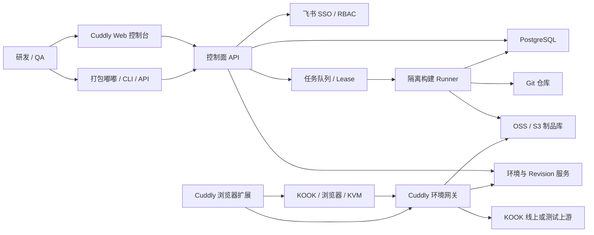

# Cuddly 项目前期总结

> 调研日期：2026-07-24  
> 产品模型修订：2026-07-26（QA 分支矩阵、构建无环境副作用）  
> 调研方式：只读检查 `ARCH.md` 指定的仓库、入口文档、构建脚本和关键实现。  
> 本文是项目前期结论，不代表最终技术方案已经冻结。

## 1. 执行摘要

Cuddly 不应被定义成“再做一个 Bifrost”或“给打包脚本套一个页面”，而应被定义成一套面向 KOOK 前端研发与 QA 的**内部交付和多环境测试平台**。

它需要统一解决四件事：

1. 从指定仓库和分支构建 webapp、在线 H5、biz 和 Module Federation Remote。
2. 把构建产物作为带有明确“项目 / 包 / 分支 / 打包时间”标签的独立制品保存和服务化。
3. 通过一张完整的“包 → 当前选中分支产物”面板，把不同制品组合成彼此隔离、可复制、可回滚的测试环境。
4. 复用线上或测试上游能力，通过代理和响应覆盖提供接近真实业务的私服环境，并用飞书识别和授权公司员工。

当前最关键的架构判断是：

- **环境必须成为一等公民。** 每个需求拥有自己的环境，不再共同修改一份全局配置。
- **构建和环境选择必须彻底解耦。** 构建只产生一个带分支标签的候选制品，不自动上传到某个环境、不自动覆盖某个包，也不自动改变任何 QA 正在使用的配置。
- **QA 的唯一主视图是完整包矩阵。** 对每个包直接展示当前使用的分支和打包时间，而不是展示“这次打了什么、前几次又叠加了什么”。
- **分支是 QA 关注的版本标识。** commit SHA 不作为产品概念和交互信息，Cuddly MVP 也不要求解析或存储源码 SHA。
- **新包就绪不等于环境切换。** QA 点击“打最新包”后只会得到一个新的候选制品，仍需明确执行“使用此包”才会改变环境。
- **构建机不能再共享一个会被反复 checkout 的工作目录。** 每个任务使用隔离的 clone、容器或沙箱。
- **Cuddly 应兼容 KOOK 已经完成的热更协议。** 客户端侧的 Remote 加载、批次检测、重启阻断和运行时替换已经存在，Cuddly 的重点是构建、制品、下发和环境编排。
- **“打包嘟嘟”应保留名称和交互入口，但降级为 Cuddly API 的客户端。** 它不再直接拥有 Git 和构建状态。

一句话概括：**Cuddly 是以“每个包当前使用哪个分支产物”为核心视图的 KOOK 前端测试环境控制面，不是单台打包机，也不是单个代理站。**

## 2. 调研范围

| 项目 | 当前作用 | 与 Cuddly 的关系 |
| --- | --- | --- |
| `kook` | KOOK 前端 Monorepo，包含 webapp、Electron 外壳、离线 H5、13 个现役 Remote 及共享包 | 核心构建对象和热更协议来源 |
| `html_h5` | KOOK 移动端在线 H5，独立仓库 | 后续需要纳入构建与环境服务 |
| `biz-fe` | KOOK 商户后台前端 | 前期只确认边界，后续纳入构建与代理 |
| `bifrost-mis` | Bifrost 管理前端 | 可继承配置交互和已有覆盖能力 |
| `bifrost-kookapp` | 反向代理型私服后端 | 可继承代理、Cookie 改写、响应拦截思路 |
| `kook-builder` | KOOK 频道里的“打包嘟嘟”机器人 | 可保留入口，执行层应迁入 Cuddly |
| `kook-kvm` | PC KOOK 多版本、环境和数据隔离工具 | Cuddly 的客户端环境入口，不应被替代 |
| `project-kfc` | 内部异构工具统一分发平台 | 可复用飞书 SSO、API、测试和工具分发经验 |
| `kaccount-switch` | 快速切换 KOOK 账号的浏览器扩展 | 浏览器扩展形态参考 |
| `misemu` | 为 KOOK MIS 特权接口提供本地 REST/MCP 代理 | 说明内部能力服务化模式，前期不纳入核心 |

`apps/h5` 是随主仓库和客户端分发的离线 H5，`html_h5` 是在线 H5。两者不能在 Cuddly 的项目模型中合并为一个目标。

## 3. 已有系统现状

### 3.1 KOOK 主仓库与热更链路

KOOK 主仓库已经从单体 webapp 演进为 pnpm workspace 下的 Module Federation 架构：

- `apps/webapp` 是 Host。
- `base`、`discover`、`gift`、`guild`、`help_center`、`mall`、`order_tracker`、`profile`、`settings`、`thread`、`tutorial`、`voice_runtime`、`voice_panel` 是当前代码识别的 13 个 Remote。
- Remote 使用 Rspack 和 Module Federation 构建，输出版本化目录及 `remoteEntry.js`。
- webapp 本体不可通过 Remote 热更，仍需单独构建和发布。

非开发环境启动时，webapp 会请求 `/api/v3/version/hot-module`，用后端返回的全量 Remote map 决定本次会话加载哪些版本。请求已经包含 webapp 版本、addon map 版本和已应用发布游标。

当前代码中的两个关键开关均为启用状态：

- 启动期消费后端 Remote map。
- 对后端明确允许且 teardown 安全的 Remote 执行运行时热替换。

运行中检测到新批次后：

- 批次内任一模块要求重启时，整批不部分应用，等待客户端重启。
- 可热替换批次会根据 Remote 是否活跃选择立即替换、等待安全窗口或降级为重启。
- `voice_runtime` 有物理硬限制，不允许运行时替换。
- 加载失败、依赖不满足和部分替换失败都有保守降级路径。

因此，Cuddly 不需要重新发明客户端热更协议。它需要正确提供全量 map、制品 URL、批次元数据和环境级下发策略。

### 3.2 现有 Remote 构建与上传

每个 Remote 已具备相似的 `build:ttt`、`upload:ttt`、`build:prod`、`upload:prod` 脚本：

- 测试产物上传到测试 OSS/CDN。
- 生产产物上传到生产 OSS/CDN。
- 现有版本名通常由包名、环境、时间和短 Git SHA 组成；这是当前脚本事实，不代表 Cuddly 需要把 SHA 暴露给 QA。
- 根脚本支持通过 `--only` 选择部分 Remote，并有串行和并行两种执行器。
- 构建完成后会更新 webapp 内置的 fallback map。

这些脚本解决了“在一个已经准备好的 checkout 中构建并上传哪些 Remote”，但没有解决：

- 任意需求从多个分支组合产物，并清楚展示每个包当前选择的分支。
- 多个需求同时构建且互不修改工作区。
- 构建任务、日志、制品和环境发布的持久化记录。
- QA 自助创建、克隆、切换和回收环境。

仓库内另有面向正式发布的 MIS 方案，核心是固定 `master`，根据上次发布 SHA 计算增量 Remote。该方案适合正式发布提效，但它以“上次到本次的增量”为中心，不适合 Cuddly 面向 QA 的完整分支矩阵：QA 需要直接看到当前每个包是什么分支，而不是理解多次增量打包后形成的叠加结果。

### 3.3 Bifrost 的实际形态

Bifrost 后端基于 Express 和 `http-proxy-middleware`，主要做法不是复制 KOOK 后端，而是代理真实上游：

1. 主站请求代理到 KOOK 线上站点。
2. 静态资源和图片域名代理到 Bifrost 域名。
3. 改写上游 `Set-Cookie` 的 Domain，使登录态能在代理域名工作。
4. 对选定 JSON 接口进行响应覆盖，例如用户设置、发现页、商城和热更 map。
5. 对 HTML 和 `remoteEntry.js` 注入 `k-inject.js`。
6. 注入脚本继续处理图片 URL、消息内容、WebSocket 数据和 H5 iframe 跳转。

Bifrost 管理端是 React 19、TypeScript、Vite 和 HeroUI。管理员配置最终整体写入后端的一份进程级 `misData`，并持久化到单个 JSON 文件。

这套实现证明了以下路线可行：

- 复用真实上游数据和实时链路，只覆盖前端需要控制的部分。
- 在不等待正式后端能力的情况下验证 Remote 和接口效果。
- 通过 KVM 把不同 PC 版本指向 Bifrost，形成接近真实客户端的测试入口。

但它目前仍是单环境实现：所有访问者共享同一份覆盖配置和同一套 Remote 组合。

### 3.4 打包嘟嘟

现有“打包嘟嘟”使用 Bun 和 KOOK Bot SDK，运行在 Docker 中。收到 `/打包 <项目> <分支>` 后，它会在共享仓库目录中：

1. 切换 Node 版本。
2. `git fetch`、清理工作区、checkout 指定分支并 pull。
3. 执行项目级构建命令。
4. 把 stdout/stderr 输出到容器日志，并在频道回复成功或失败。

它已经有项目名校验、宿主目录限制和“同一项目同一时刻只允许一个任务”的保护，但其模型仍然是“共享 checkout 上的一次远程 shell”：

- 分支切换会改变整个项目状态。
- 同项目不能并发，不同模块也没有独立源码快照。
- 没有持久队列、任务取消、重试、制品索引和审计模型。
- 项目构建配置由机器人仓库维护，目标项目和平台元数据没有形成统一协议。
- Bot 指令权限没有细分为开发、QA 和管理员能力。

它适合做 Cuddly 的通知和快捷入口，不适合继续承担核心执行职责。

### 3.5 KVM、KFC 与其它工具

KVM 已解决 PC 客户端多版本共存、环境切换、数据隔离和强更屏蔽，并明确支持 Bifrost URL。Cuddly 应输出可被 KVM 直接使用的环境地址，而不是重做 PC 版本管理。

KFC 已形成较成熟的内部工具平台范式：

- React/TypeScript 前端与 Tauri/Rust 宿主分层。
- Bun/Hono 后端、清晰 API、飞书 SSO、JWT 和上传权限。
- manifest 驱动的异构工具适配。
- 核心逻辑与副作用端口分离，并有单测和真实 E2E。

Cuddly 可以参考其工程组织、鉴权和测试方法，但不能直接照搬 KFC 的文件系统数据模型。Cuddly 存在并发任务、环境版本、制品引用、权限和审计关系，适合使用事务数据库。

`html_h5` 和 `biz-fe` 都已有独立构建体系。在线 H5 仍保留较多历史依赖和多环境代理配置；biz 使用 React 18 与 Rspack。Cuddly 应通过项目适配器接入，而不是要求它们先迁移到与 KOOK Monorepo 相同的构建结构。

## 4. 为什么前端团队需要 Bifrost

“后端长期无法提供方便的线上热更测试环境”是直接原因，但不是全部原因。

### 4.1 需要真实度，而不是另一套残缺 Mock

KOOK 涉及登录态、Cookie、IM/WebSocket、CDN 资源、PC 壳、在线 H5 和大量真实业务接口。重新实现一套测试后端成本极高，也很容易与线上行为漂移。

Bifrost 通过代理真实上游，只在响应出口做小范围覆盖，以较低成本获得了接近线上环境的真实度。

### 4.2 前端需要独立控制 Remote 版本

热更的本质是让 Host 加载指定的 `remoteEntry.js`。如果正式后端没有为任意分支产物提供可配置下发，前端即使已经构建出包，也无法让目标客户端稳定加载它。

Bifrost 把 Remote map 的控制权交给前端，补上了“产物已经存在，但无法方便地下发给测试用户”的缺口。

### 4.3 测试需求经常跨越正式系统边界

测试的不只是一个 Remote：

- 某些需求同时改多个 Remote，并存在版本配套关系。
- 某些需求需要覆盖接口数据或用户设置。
- 某些页面通过 iframe 进入在线 H5。
- 静态资源、消息内容和 WebSocket 数据里可能继续出现正式域名。

单纯替换一个 API 地址或上传一个包不足以形成完整测试环境。Bifrost 的代理与注入脚本承担了跨边界拼接工作。

### 4.4 需要兼容多个 PC 版本

QA 经常需要验证不同 KOOK 客户端版本。KVM 能把不同 PC 版本指向 Bifrost，并隔离本地数据，使同一台机器可以复现不同客户端组合。

这让 Bifrost 从“网页代理”变成了可被真实客户端使用的环境。

### 4.5 前端需要更短的反馈闭环

接口、发布后台或正式打包系统出现阻塞时，前端团队仍需要推进联调和 QA。Bifrost 将部分环境能力放在前端团队可维护的范围内，缩短了跨团队排期和故障等待时间。

### 4.6 还承担了实验和故障绕行能力

现有实现已用于商城换肤、发现页数据、用户设置、提示消息和新版/旧版热更覆盖。这说明 Bifrost 实际上还是一个小型响应实验平台，而不仅是热更服务器。

## 5. 当前问题的根因

### 5.1 环境是全局可变状态

Bifrost 只有一份全局配置。A 需求保存配置后，B 需求看到的也是同一份结果。测试失去并行能力不是操作问题，而是数据模型里根本没有“环境”这一层。

### 5.2 源码工作区也是全局可变状态

打包机在共享 clone 中切分支。A 需求构建 `feature/A_1` 后，再为 `feature/A_2` 或 B 需求 checkout，会改变整个仓库。即使 Remote 构建可以并行，源码层也没有隔离。

### 5.3 构建、制品和环境选择互相耦合

目前用户需要知道：

- 应该切哪个分支。
- 应该执行哪个项目脚本。
- 哪些 Remote 要打。
- 产物最终叫什么。
- 上传到了哪里。
- Bifrost 管理端应该填写哪个版本字符串。

这些步骤依靠少数人的隐性知识串联，而且“打包成功”经常被默认理解为“应该去改当前环境”。构建本应只负责产出制品，是否使用该制品必须是另一项明确操作。

### 5.4 缺少面向 QA 的完整当前状态

现有流程容易把环境描述成一串操作历史：这次打了哪些包、下次补了哪些包、后来又覆盖了哪些版本。经过多轮操作后，QA 很难一眼确认当前真实组合。

Cuddly 不能让 QA 重放这段历史来理解环境。环境首页必须始终直接展示完整真相：

- `base` 当前使用哪个分支的哪个打包产物。
- `gift` 当前使用哪个分支的哪个打包产物。
- `voice_runtime` 当前使用哪个分支的哪个打包产物。
- 其它包依此类推。

每一行都应显示当前分支、当前产物打包时间、该分支是否已有更新的候选产物，以及明确的切换操作。

### 5.5 缺少制品层

现有流程直接从“构建完成”跳到“某个 URL 可用”，缺少统一的制品记录。系统无法可靠回答：

- 这个包来自哪个项目、包和分支，是什么时间构建的。
- 谁在什么时候发起了构建。
- 哪些环境正在使用它。
- 是否能安全删除。
- 如何精确回滚到上一次组合。

### 5.6 私服覆盖范围和实现方式都有限

- 当前主要覆盖主站，在线 H5 和 biz 没有形成完整的一体化环境。
- 响应拦截规则硬编码在服务代码中，难以按环境启停和版本化。
- HTML 字符串匹配、全局对象 Hook 和域名替换容易随上游改版失效。
- 管理接口、飞书登录和授权仍是原型形态，尚未形成完整安全边界。

### 5.7 服务可达性不符合日常协作方式

已有打包服务依赖公司内网，WFH 不友好。公网化不能只暴露端口，还必须同时解决公司身份、权限、源码凭据、构建机隔离、日志脱敏和访问审计。

## 6. Cuddly 的目标与边界

### 6.1 目标

- 支持 KOOK Monorepo、在线 H5 和 biz 的统一构建入口。
- 支持 webapp、Remote、H5 和 biz 制品的上传、保存和服务。
- 支持按项目、包和分支发起构建；构建结果只进入制品库，不自动改变任何环境。
- 为 QA 提供完整的包矩阵，每个包清楚显示当前分支、当前产物打包时间和可选分支。
- 支持 QA 在面板上为任意分支发起“打最新包”，并在构建完成后明确选择是否使用新产物。
- 支持多个需求同时拥有独立环境，并能克隆、修改、冻结和回滚。
- 支持复用 KOOK 上游的代理型私服，并按环境覆盖响应。
- 支持飞书 SSO、公司员工识别、角色权限和完整审计。
- 提供稳定 API、CLI/SDK 和“打包嘟嘟”封装。
- 提供浏览器扩展，用于选择环境、跳转环境和安装必要的页面侧 Hook。
- 支持公网安全访问，满足 WFH。

### 6.2 非目标

- 不重写 Electron 外壳、KVM 或 PC 版本安装能力。
- 不重写 KOOK webapp 已有的 Remote 热更状态机和运行时替换协议。
- 不替代 KFC；Cuddly 的辅助 CLI 和扩展反而可以通过 KFC 分发。
- 不在首期复制 KOOK 全套后端，也不建设通用 Mock 平台。
- 不要求所有被接入项目先统一技术栈或目录结构。
- 不在首期承担生产环境正式发布；生产发布与 QA 环境编排应有清晰权限边界。

## 7. 建议的核心领域模型

### 7.1 Project

描述一个可构建项目：源码仓库、默认分支、凭据引用、构建适配器和允许的目标。首批至少包括：

- `kook-webapp`
- `kook-remotes`
- `html-h5`
- `biz-fe`

### 7.2 Build Target

项目内可独立构建的目标，例如 `webapp`、`base`、`voice_runtime`、`online-h5`、`biz`。目标声明：

- 工具链或构建镜像。
- 构建命令。
- 输出目录和入口文件。
- 目标平台或环境 profile。
- 是否允许并行。
- 需要哪些凭据和网络权限。

### 7.3 Branch Build Catalog

Branch Build Catalog 是 QA 下拉框的数据来源。它按 Build Target 维护各分支的构建可用性：

- 分支名。
- 是否存在成功产物。
- 上次成功打包时间。
- 上次成功产物。
- 当前是否正在构建。
- 最近一次失败及其日志入口。

分支列表可以来自 Git 仓库，产物信息来自 Cuddly。一个分支即使从未打过包，也可以出现在下拉框中，此时明确显示“暂无产物”，并提供“打最新包”。

这里的“最新”只表示该分支最近一次成功构建出的候选制品，不代表任何环境会自动使用它。

### 7.4 Build Job

一次构建任务必须固化：

- 项目、Build Target 和分支名。
- 构建 profile、参数和工具链镜像版本。
- 发起人、状态、时间、日志和失败原因。
- 产出的 Artifact。

任务应支持排队、取消、超时、重试和并发配额。

Build Job 的职责到“产物准备好”即结束。成功后只更新 Branch Build Catalog，不修改 Environment、不修改 Remote map，也不触发任何自动部署。

Cuddly MVP 不要求解析或存储 commit SHA。构建任务以“包 + 分支 + 发起时间”作为业务输入，QA 的选择、回滚和审计也都不依赖 SHA。

### 7.5 Artifact

Artifact 是不可变制品，至少记录：

- 项目、Build Target 和分支标签。
- 打包时间、发起人和 Build Job。
- 对象存储地址和用于完整性校验的内容摘要。
- `remoteEntry.js`、webapp 入口或 H5/biz 入口。
- 保留策略和当前引用它的环境。

相同内容可以去重，但不能在原地址上静默覆盖。

同一分支允许保留多个历史 Artifact。Catalog 可以标记其中“最近一次成功构建”，但该标记只是方便 QA 选择，不能成为环境运行时的动态引用。

### 7.6 Package Selection

Package Selection 表示一个环境中的某个包当前到底在使用什么。它必须固定到一个具体 Artifact，而不是固定到“某分支的最新包”：

```text
环境 A / base
  当前分支：feature/A_1
  当前产物：artifact-base-1842
  打包时间：2026-07-26 10:30
```

这样，即使 `feature/A_1` 在 11:00 又打出了新包，环境 A 仍继续使用 10:30 的产物，直到 QA 明确选择新产物。

### 7.7 Environment

Environment 是 QA 实际使用的独立工作空间，例如 `feature-a`、`feature-b`。它包含：

- 一张完整 Package Selection 表，覆盖 webapp、每个 Remote、在线 H5 和 biz。
- 每个包当前 Artifact 对应的分支标签和打包时间。
- 未选择自定义产物的包所使用的明确 fallback。
- 上游环境选择。
- 响应覆盖规则集。
- 访问成员、状态、TTL 和环境地址。

Environment 的真相是当前完整表格，不是过去执行过的构建、合并和覆盖动作列表。

### 7.8 QA 包矩阵面板

环境首页应直接呈现类似下面的表格：

| 包 | 当前使用分支 | 当前产物打包时间 | 分支选择 | 所选分支最新打包 | 操作 |
| --- | --- | --- | --- | --- | --- |
| `base` | `feature/A_1` | 07-26 10:30 | `feature/A_1` | 07-26 11:00 | `使用新包` / `打最新包` |
| `gift` | `feature/A_1` | 07-25 18:20 | `feature/A_1` | 07-25 18:20 | `打最新包` |
| `voice_runtime` | `master` | 07-26 09:10 | `feature/A_2` | 暂无产物 | `打最新包` |

交互契约如下：

1. “当前使用分支”和“当前产物打包时间”永远描述环境正在运行的具体 Artifact。
2. 分支下拉框列出各分支及其上次成功打包时间；无产物分支明确标记“暂无产物”。
3. QA 选择一个已有产物的分支并确认后，环境切换到该分支当时选中的具体 Artifact。
4. `打最新包` 只为当前查看的分支创建 Build Job，不改变环境。
5. 构建完成后，面板显示“有新包可用”和 `使用新包`；只有 QA 点击后才切换。
6. 如果一次要切换多个包，先在面板形成完整待应用表，再一次确认、原子生效，避免半切换。
7. 页面可以提供构建历史和 Revision 历史作为辅助信息，但不能让操作历史取代当前包矩阵。

### 7.9 Environment Revision

每次修改环境都生成新 Revision。Revision 是不可变快照，保存完整组合而不是只保存差异。

Revision 内保存每个包选择的具体 Artifact，以及用于 QA 展示的分支标签和打包时间。切换环境时只原子切换当前 Revision 指针，因此可以：

- 一键克隆环境。
- 一键回滚。
- 对比两个环境。
- 明确知道每次测试使用的完整包、分支和打包时间。
- 在更新多个 Remote 时避免半发布状态。

回滚直接恢复历史 Artifact 引用，不需要 QA 提供或理解 commit SHA，也不需要重新构建同名分支。

### 7.10 Proxy Rule Set

把 Bifrost 中硬编码的响应覆盖逐步变成版本化规则：

- 匹配请求方法、路径和可选条件。
- 选择 JSON merge、JSON patch、完整替换、重定向或脚本注入。
- 规则按环境启用，不修改其它环境。
- 对高风险规则进行 schema 校验、大小限制和审计。

首期不必提供任意代码执行；优先支持经过审核的内置规则类型。

## 8. 建议架构



### 8.1 控制面

负责项目配置、构建任务、制品、环境、权限和审计。控制面不直接执行项目构建命令。

### 8.2 Runner 面

Runner 从队列领取任务，在隔离工作目录或临时容器中 checkout 用户指定的分支，并以任务开始时取得的代码执行适配器。建议：

- 不共享可变 Git checkout。
- 不把宿主 Docker Socket 暴露给不可信构建。
- 构建凭据按任务短期注入并最小授权。
- 每类项目使用明确的工具链镜像或版本声明。
- stdout/stderr 实时回传，同时保存完整日志。
- 上传成功后返回结构化制品清单，不由聊天消息解析产物。
- 任务成功只登记新的分支候选 Artifact，不调用环境切换接口。

### 8.3 制品面

使用 OSS/S3 兼容对象存储保存内容寻址或唯一版本路径的制品。数据库保存元数据和引用关系。

Remote 产物应能直接得到稳定的 `remoteEntry.js` URL。webapp、H5 和 biz 可以由网关反代对象存储，也可以发布到专用静态站点。

### 8.4 环境网关

网关是 Bifrost 的演进方向，负责：

- 根据域名、环境 ID 或签名会话解析 Environment Revision。
- 服务选定的 webapp/H5/biz 制品。
- 代理未覆盖的 KOOK 上游请求。
- 返回该环境完整的 `/v3/version/hot-module` map。
- 应用该环境的响应规则。
- 正确处理 Cookie Domain、CORS、CSP、压缩、缓存和 WebSocket。

优先考虑“每环境一个独立二级域名”。它对 QA 最直观，也更适合 KVM。若采用单域名加 Cookie/Header 选择环境，必须先验证 Electron、WebSocket 和跨域登录链路。

### 8.5 浏览器扩展

扩展的主要职责应是：

- 展示用户可访问的环境并快速切换。
- 把正式站点导航到对应环境。
- 为必须在页面上下文完成的能力注入小型、版本化 Hook。
- 提供环境标识，避免测试人员误把当前页面当成生产。

不应把整个代理逻辑重新塞入扩展；核心响应修改仍由服务端网关完成。

## 9. 技术栈建议

### 9.1 总体原则

优先延续 KFC、KVM 和现有前端工具已经验证的 TypeScript、React、Bun/Node、Rust/Tauri 生态，但按模块职责选择，不为了“统一”而强行使用同一种运行时。

### 9.2 推荐候选

| 层 | 建议 | 说明 |
| --- | --- | --- |
| Web 前端 | React + TypeScript + Vite | 与 KFC、Bifrost 和内部经验一致 |
| 控制面 API | TypeScript；Bun + Hono 或 Node LTS + Fastify/Hono | 先通过飞书鉴权、代理流式响应和任务日志 PoC 决定运行时 |
| 数据库 | PostgreSQL | 适合任务、环境 Revision、权限、审计和事务切换 |
| 队列 | 首期可用 PostgreSQL lease；规模扩大后引入 Redis/NATS | 避免 MVP 过早增加基础设施 |
| 制品存储 | 阿里云 OSS 或 S3 兼容存储 | 与现有 Remote 上传体系衔接 |
| Runner | Linux + Docker/容器隔离 | 支持固定工具链、资源限制和任务清理 |
| 边缘入口 | Nginx/Caddy + 应用层代理网关 | 前者处理 TLS，后者处理动态环境和响应变换 |
| 鉴权 | 飞书 OAuth/OIDC 风格登录 + Cuddly 自有会话/JWT | 不向前端暴露飞书 access token |
| 测试 | Vitest/Bun test + API 集成测试 + Playwright E2E | 覆盖从建环境到客户端访问的真实闭环 |
| 可观测性 | 结构化日志、任务指标、审计事件，后续接 OpenTelemetry/Sentry | 构建失败和代理异常必须可定位 |

如果未来需要本地辅助客户端，再评估 Tauri；首期 Web 控制台和浏览器扩展已经足够，不需要先做桌面端。

## 10. API 与易用封装

Cuddly 应从第一期就坚持 API-first。Web、Bot、CLI 和自动化都调用同一组业务 API。

建议首批能力：

- 查询 Build Target 的分支列表、上次成功打包时间和最新候选 Artifact。
- 创建构建任务，指定项目、目标、分支和 profile。
- 查询任务状态和流式日志。
- 查询、下载和保留制品。
- 创建、克隆、更新、发布、回滚和删除环境。
- 读取环境完整包矩阵。
- 为环境中的某个包明确选择一个已有 Artifact，并原子发布新的完整矩阵。
- 获取环境完整配置和访问链接。
- 管理成员、角色和项目权限。

API 需要幂等键，避免 Bot 或网络重试重复创建构建和发布。

“打包嘟嘟”可以演进成：

```text
/打包 base feature/A_1
/打包 gift feature/A_1
/打包 voice_runtime feature/A_2
/环境 创建 A需求
/环境 选择 A需求 base feature/A_1
/环境 链接 A需求
```

Bot 只负责解析意图、调用 API、展示状态和通知完成，不直接执行 shell。`/打包` 成功后只通知“新产物已就绪”，不能自动执行 `/环境 选择`。

## 11. 建议分期

### 阶段 0：协议与风险验证

- 验证 KOOK、KVM、浏览器访问独立环境域名的 Cookie、WebSocket、CORS 和登录链路。
- 验证网关返回自定义全量 hot-module map。
- 验证 Runner 按包和分支隔离构建一个 Remote，并把产物登记到 Branch Build Catalog。
- 验证新构建完成不会改变任何环境，只有明确选择 Artifact 才更新环境。
- 明确现有 Bifrost OSS 的实际上传和部署机制；本次调研只发现 URL 约定，未在指定仓库中发现完整 uploader。

### 阶段 1：Remote 多环境最小闭环

- 飞书 SSO 和基础角色。
- KOOK Remote 构建任务、日志和不可变制品。
- Branch Build Catalog、Package Selection、Environment 和 Revision 数据模型。
- QA 完整包矩阵、分支下拉框、上次打包时间、`打最新包` 和 `使用新包` 交互。
- 每环境独立地址和完整 Remote map。
- 环境创建、克隆、发布、回滚和 TTL。
- 至少支持两个需求同时配置不同 Remote 组合并由 KVM 访问。

这一阶段完成后，应先解决 QA 当前最痛的并行测试问题。

### 阶段 2：完整主站交付链

- webapp 构建与服务。
- 打包嘟嘟 API 化。
- CLI/SDK、任务取消、重试和并发配额。
- 公网 TLS、WFH 访问、审计和凭据治理。
- Bifrost 现有设置、商城、发现页等覆盖能力迁移为环境规则。

### 阶段 3：H5、biz 与浏览器扩展

- 接入 `html_h5` 构建与环境路由。
- 接入 `biz-fe` 构建与代理。
- 完成浏览器扩展的环境选择和页面侧 Hook。
- 支持跨 webapp/H5/biz 的同一环境 Revision。

### 阶段 4：平台化与稳定性

- Runner 横向扩容、优先级和资源配额。
- 制品生命周期、垃圾回收和容量治理。
- 环境模板、审批、通知和自动回收。
- 更完整的指标、告警、SLO 和灾备。
- 评估与正式发布后台的集成边界。

## 12. MVP 验收标准

第一期不以页面数量或技术栈落地为验收，而以以下业务闭环为准：

1. QA 可以为 A、B 两个需求分别创建环境，两者同时在线且互不影响。
2. 环境首页一次性列出所有包，并清楚显示每个包当前使用的分支和当前产物打包时间。
3. 每个包都有分支下拉框，选项能显示该分支上次成功打包时间或“暂无产物”。
4. A 环境可以组合 `feature/A_1` 的 `base/gift/discover` 与 `feature/A_2` 的 `voice_runtime`；B 环境可以同时使用另一组分支。
5. QA 可以在任意包行上点击 `打最新包`，看到构建状态、实时日志和明确错误。
6. 构建成功只产生新的候选 Artifact；A、B 以及其它环境的当前配置均不会自动变化。
7. 新候选就绪后，QA 必须点击 `使用新包` 或确认完整待应用矩阵，环境才发生切换。
8. 环境发布是原子的，不会出现 Remote map 只更新一半。
9. 任意环境可以一键克隆和回滚到上一 Revision；回滚恢复原 Artifact，无需理解 SHA。
10. KVM 能使用环境链接启动目标 PC 版本，浏览器也能直接访问。
11. WFH 用户通过飞书登录后可使用被授权环境，未授权用户无法访问源码构建、制品和管理接口。
12. 系统能回答“谁在何时为哪个包和分支打了包、当前哪些环境正在使用这个具体产物”。

## 13. 主要风险与待确认事项

### 13.1 安全

构建任意分支等同于在构建机执行仓库代码。Runner 必须与控制面、数据库和宿主机隔离，且不能长期持有生产 OSS、Git 写权限或其它高权限凭据。

Bifrost 会接触真实登录态和业务数据。日志必须默认脱敏，响应覆盖和调试能力必须有权限边界。

### 13.2 上游协议稳定性

当前 Bifrost 依赖 HTML 特征、字符串替换和页面全局对象。Cuddly 应尽量把逻辑下沉到稳定 HTTP 路由和结构化 JSON 变换；确实只能注入的能力需要版本、健康检查和快速关闭开关。

### 13.3 构建兼容性

KOOK Monorepo 的 webapp 依赖 workspace 源码和 submodule，在线 H5 与 biz 又有不同的 Node、包管理器和历史工具链。项目适配器必须显式声明这些差异，不能假设统一执行 `npm install && npm run build`。

### 13.4 版本兼容矩阵

需要确认 PC build、webapp 渲染层、addon map 和 Remote 之间的兼容约束，以及环境是否允许用户主动选择不兼容组合。首期建议默认保守校验并允许管理员显式覆盖。

### 13.5 域名与证书

每环境子域名需要通配符 DNS/TLS、Cookie Domain 策略和上游回调兼容。若公司域名或证书无法满足，需要尽早确定替代路由模型。

### 13.6 存储和回收

不可变制品会持续增长。必须区分：

- 被环境 Revision 引用的制品。
- 手动保留的制品。
- 可按 TTL 清理的临时制品。

删除动作必须先做引用检查。

### 13.7 与正式发布系统的边界

当前主仓库已有正式 Remote 增量发布设计，后端也已有打包后台。Cuddly 首期应服务 QA 和研发自测，不直接接管生产发布。等制品、权限和审计稳定后，再评估复用同一控制面还是只做 API 对接。

## 14. 可直接继承的资产

- KOOK 的 Remote 构建脚本、版本命名、上传公共逻辑和 hot-module 客户端协议。
- Bifrost 的上游代理、Cookie 改写、响应拦截用例和 `k-inject.js` 中已验证的兼容问题清单。
- 打包嘟嘟的 KOOK Bot 交互、项目配置经验和构建通知形式。
- KVM 的 PC 多版本、环境切换和数据隔离能力。
- KFC 的飞书 SSO、JWT、权限、manifest、Host 端口分层和测试体系。
- kaccount-switch 的浏览器扩展构建与 KFC 分发链路。

应继承的是能力和经验，不是现有全局状态、硬编码域名、共享 checkout 或部署脚本。

## 15. 前期结论

Cuddly 的首要交付不是“支持更多项目”，而是把现有链条从**一台机器、一个 checkout、一份配置、一个环境**改造成：

```text
按包、按分支的隔离构建
        ↓
只进入制品库的分支候选产物
        ↓
QA 可直接看懂的完整包 → 分支产物矩阵
        ↓
明确确认后才生效的环境 Revision
        ↓
按环境路由的代理私服
        ↓
KVM / 浏览器 / Bot / API 的统一入口
```

只要第一期真正做到“一个需求一个环境、每个包清楚显示当前分支、打包只产生候选产物、切换必须由 QA 明确确认”，QA 并行测试和流程知识集中问题就会被结构性解决。后续接入 H5、biz、浏览器扩展和正式发布，都会建立在同一套模型上，而不需要继续叠加临时脚本。

## 16. 事实来源索引

本次重点核对了以下实现和文档：

- `kook/apps/webapp/src/_core/remote-load-flags/index.ts`
- `kook/apps/webapp/src/_core/hot-update-service/index.ts`
- `kook/apps/webapp/src/_app/bootstrap/installRemotes.ts`
- `kook/apps/webapp/src/_app/bootstrap/applyHotUpdate.ts`
- `kook/apps/webapp/src/_app/bootstrap/remoteHotSwap.ts`
- `kook/apps/webapp/src/_app/remotes/remoteEntries.ts`
- `kook/scripts/release_ttt_remotes.js`
- `kook/scripts/release_ttt_remotes_parallel.js`
- `kook/docs/migration/hot-update-backend-integration.md`
- `kook/docs/migration/hot-update-governance.md`
- `bifrost-kookapp/src/main.ts`
- `bifrost-kookapp/src/interceptor.ts`
- `bifrost-kookapp/src/hot-module.ts`
- `bifrost-frontend/bifrost-mis/public/k-inject.js`
- `bifrost-frontend/bifrost-mis/src/tabs/hot-module.tsx`
- `kook-builder/src/commands.ts`
- `kook-builder/src/project.ts`
- `kook-kvm/README.md`
- `project-kfc/README.md`
- `html_h5/README.md` 与构建配置
- `biz-fe/package.json` 与 Rspack 配置
- `kaccount-switch/README.md`
- `misemu/README.md`
