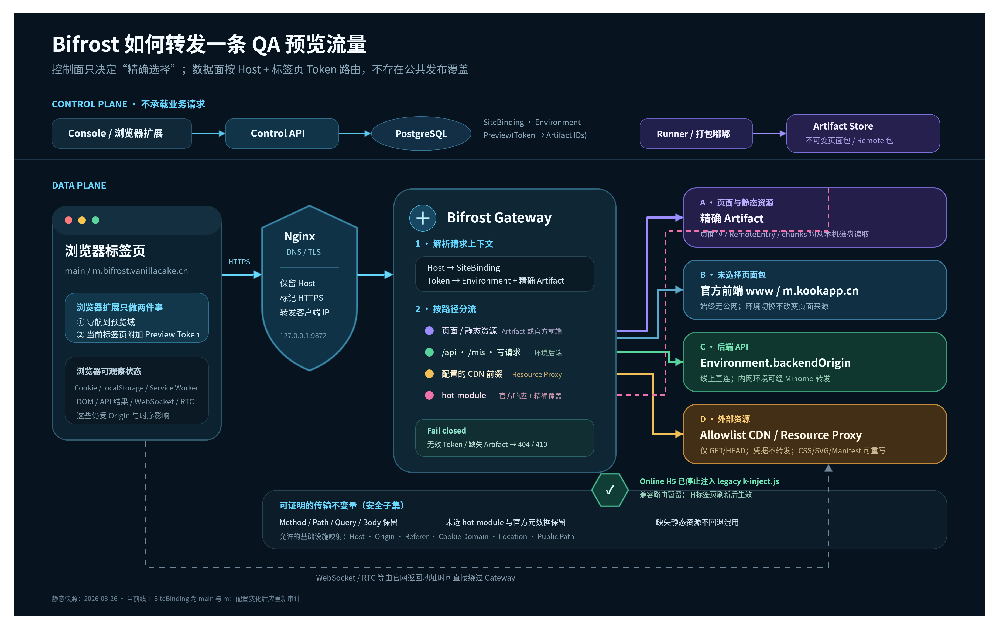

# Bifrost 流量转发与业务测试有效性

## 基于静态分析的条件式证明与例外边界

| 项目       | 内容                                                                                                        |
| ---------- | ----------------------------------------------------------------------------------------------------------- |
| 文档状态   | Conditional assurance case（条件式保证论证）                                                                |
| 分析日期   | 2026-08-26                                                                                                  |
| 分析对象   | 当前 `cuddly-umbrella` Gateway、Runner、浏览器扩展、部署配置，以及 KOOK Webapp / Online H5 源码的启发式扫描 |
| 目标读者   | QA、前端开发、Bifrost 维护者、测试负责人                                                                    |
| 结论有效期 | 仅对本文记录的代码、配置和 Artifact 证据成立；任一项变化后需要重新生成报告                                  |

> [!IMPORTANT]
> 本文不能、也不会证明“Bifrost 在所有情况下与官网完全相同”或“测试质量绝对不会下降”。这两个强命题在理论上不可由有限静态分析证明，在当前实现中也存在明确反例。
>
> 本文能够证明的是：**对于固定 Artifact 与固定环境，在所有前提成立、请求落入已证明的安全子集、静态扫描未发现未登记例外时，Bifrost 与该 Artifact 的正常 KOOK 部署在业务观察层面构成条件式弱观察等价；因此这些路径上的功能测试结果具有迁移性。**

## 0. 执行摘要

### 0.1 三个必须区分的命题

1. **强命题 S：Bifrost 对任意业务代码、任意浏览器行为都完全透明。**
   - 结论：不成立。
   - 一般反例包括 `location.origin` 分支、Cookie/Storage、OAuth、Service Worker、WebSocket、签名、防盗链、缓存与时序。
   - 仓库曾存在一个真实反例：Online H5 无条件注入 `legacy/bifrost-mis/public/k-inject.js`；当前版本已停止注入，但一般反例仍然成立。
2. **条件命题 C：在明确安全子集内，Bifrost 只进行可逆的基础设施地址搬迁，不额外改变业务状态迁移。**
   - 结论：可以通过当前静态代码建立一组条件式引理。
3. **流程命题 Q：在 Bifrost 上测试不会降低测试质量。**
   - 结论：静态分析不能直接证明“质量”。能证明的是测试结果对参考部署的可迁移性；覆盖率、人员判断、环境数据、性能与第三方系统仍需过程和运行时证据。

### 0.2 当前证据等级

| 能力                                        | 结论                   | 理由                                                               |
| ------------------------------------------- | ---------------------- | ------------------------------------------------------------------ |
| Preview 固定精确 Artifact，构建后不自动替换 | 已建立                 | Preview 保存 Artifact ID；Gateway 不按分支动态解析                 |
| 其它标签页不被当前 Preview 影响             | 已建立                 | Site Preview 的 DNR 与官网原地模式的配置都以 `tabId` 为边界        |
| 选中 Artifact 缺文件时不会偷偷混入官网资源  | 已建立                 | 预期静态路径直接 404；无效 Preview fail closed                     |
| 后端业务请求的 method/path/query/body 保留  | 已建立，但请求头有条件 | Host、Origin、Referer、Accept-Encoding 等会变化                    |
| hot-module 未选模块与官方元数据保留         | 已建立                 | 在官方完整响应上按 key 局部 overlay                                |
| 官网原地 hot-module 请求身份与参数保留      | 已建立                 | 原生 `fetch` 仍原样、同源请求官方；不做跨域重定向                  |
| 普通二进制 Artifact 字节保持                | 已建立                 | Manifest 精确文件与 digest，流式读取；HTML/CSS 除外                |
| CDN 资源搬迁不改变内容                      | 有条件                 | 只对公开、无凭据、GET/HEAD 资源成立；CSS/SVG/Manifest 会规范化 URL |
| 浏览器级完整等价                            | 未建立                 | Origin、存储、安全策略、原型 Hook、缓存与网络时序可观察            |
| Online H5 未执行 legacy 主动 Hook           | 已建立                 | 当前 HTML 不再注入 `k-inject.js`；保留的兼容路由不会自行执行       |

## 1. 正确的比较对象

选择一个功能分支本来就是在改变被测业务代码，因此不能把“Bifrost 上的功能分支”与“当前 KOOK 线上 master”比较后要求两者行为相同。正确的反事实参考系统是：

- `Ref(A, E)`：把同一组 Artifact `A` 按正常 KOOK 发布方式部署到官方类域名，并连接环境 `E` 的后端。
- `BifSite(A, E, C)`：同一组 Artifact `A` 通过 Bifrost Preview 域、Gateway 和配置 `C` 运行，并连接同一环境 `E`。
- `BifInPlace(A_r, E, T_tab)`：页面、身份、后端与普通网络请求继续运行在官方 Origin；扩展只在指定标签页把官方 hot-module 成功 JSON 中的选中 key 替换为 Bifrost Remote Artifact。

这里：

- `A_s` 表示页面 Artifact；
- `A_r[k]` 表示模块 key 为 `k` 的 Remote Artifact；
- `E = (backendOrigin, useInternalProxy, resourcePrefixes)`；
- `B = (hostname, targetId, fallbackOrigin, officialOrigin, remoteTargetIds)`；
- `T` 表示一枚有 TTL 的 Preview Token，它固定 `B/E/A_s/A_r`；`T_tab` 表示扩展中按标签页保存的有效选择与其有效期。

本证明要排除的是承载层引入的额外业务差异，而不是排除所选分支自身的差异。

## 2. 真实流量结构



源文件与可导入飞书画板的产物：

- `diagrams/2026-08-26T174039/diagram.svg`
- `diagrams/2026-08-26T174039/diagram.json`

### 2.1 浏览器扩展有两种执行模式

#### 官网原地热更（Remote-only）

当未选择页面 Artifact、只选择 Remote Artifact，当前页面 Origin 等于 SiteBinding 的 `officialOrigin`，且所选环境等于该 SiteBinding 的默认 `environmentSlug` 时，扩展不跳转 Bifrost，也不用 DNR 把 hot-module 重定向到 Bifrost。之所以禁止这种重定向，是因为 KOOK 的请求包含 Cookie、Authorization 与签名头，而跨 Origin 重定向会改变请求身份边界并引入 CORS。其它环境仍降级到 Site Preview，避免官方页面与另一后端环境被错配。

扩展在 `document_start` 安装两层静态内容脚本：

1. MAIN world 脚本只包装 `window.fetch`；
2. isolated world bridge 根据 `sender.tab.id` 获取该标签页的活跃配置，只向 MAIN world 传递经过缩减的模块映射，不传递 Preview Token、登录凭据或控制台会话；
3. 对除 `/api/v3/version/hot-module` 和 `/v3/version/hot-module` 以外的请求，原生 `fetch` 原样执行；
4. 对上述两条路径，也先把原参数原样交给原生 `fetch`，依然向官方同源 URL 发送完整的 query、Cookie、Authorization 和签名头；
5. 仅在官方响应成功、可解析为受支持的 JSON 结构，且当前标签页有有效配置时，按 module key 局部 overlay；
6. 无配置、官方非成功响应、解析失败、未知 shape 或 bridge 异常时 fail-open，页面继续获得原官方响应。

证据：

- `apps/browser-extension/manifest.json`
- `apps/browser-extension/in-place-hot-module-main.js`
- `apps/browser-extension/in-place-hot-module-bridge.js`
- `apps/browser-extension/service-worker.js`
- KOOK 官方请求与签名：`C:/Users/guanz/projects/kook/apps/webapp/src/_core/request-service/index.ts`
- KOOK hot-module 调用：`C:/Users/guanz/projects/kook/apps/webapp/src/_app/bootstrap/installRemotes.ts`

选中模块的 `remoteEntry` 及后续 chunk 仍从 Bifrost 的不可变 Remote Artifact 路径加载；页面 Origin、官方接口、Cookie/Storage/Service Worker 和其余网络流量不经 Bifrost Gateway。

#### 整页 Site Preview

只要选择了页面 Artifact，或当前/目标 Origin 不满足原地模式条件，仍使用原 Site Preview 链路：

1. 创建只针对目标 `tabId`、只匹配 Preview Origin 的 DNR session rule；
2. 该规则只增加 `x-cuddly-preview-token`；
3. 把当前标签页导航到对应 `*.bifrost.vanillacake.cn`，并按场景保留 path/query/hash；
4. 离开 Preview Origin、Token 过期或主动停用后清理规则。

证据：

- `apps/browser-extension/service-worker.js`
- `apps/browser-extension/preview-routing.js`

所以“官网原地热更”只表示 Remote-only 场景；它不会、也不能把一个页面 Artifact 原地塞进已加载的官网页面。

### 2.2 官网原地热更的数据流

```text
KOOK 页面调用 fetch('/api/v3/version/hot-module?...')
  → MAIN world wrapper 立即调用原生 fetch(原 input, 原 init)
  → KOOK 官方同源接口（原 Cookie / Authorization / 签名 / query）
  → 官方成功 JSON
  → 只用该 tab 的选中 module key 局部 overlay
  → KOOK 原 Remote resolver
  → 选中 remoteEntry/chunk 从 Bifrost Artifact 路径加载

任意非 hot-module fetch
  → 原生 fetch(原 input, 原 init)

无配置 / 官方失败 / JSON 或 shape 异常
  → 返回原官方 Response（fail-open）
```

该路径不代理 hot-module 请求，因此避免了“跨 Origin redirect 丢 Authorization”与“把 KOOK Cookie/签名交给 Bifrost”两类风险。它的主要新风险是 MAIN world `fetch` 包装本身可观察，以及 fail-open 可能把“未实际覆盖”伪装成页面正常；这些风险在第 4、8、11 节单独约束。

### 2.3 Site Preview Gateway 的实际分流函数

在省略健康检查与控制端点后，当前路由可以抽象为：

```text
G(request, Host, Token):
  Binding := SiteBinding[Host]
  if Binding 不存在或停用: 404

  if Token 存在:
    Preview := PreviewSession[Token]
    校验 Preview/Binding/Environment/TTL
    任一失败: 404，不回退官网
    Context := Preview 固定的 Environment + 页面 Artifact + Remote Artifact
  else:
    Context := Binding 默认 Environment + 官方页面 + 官方 Remote

  if path 是 __cuddly Remote Artifact: 从 Artifact Store 精确读取
  else if path 是 __cuddly Resource Proxy: 只代理配置前缀内的公开资源
  else if path 是 hot-module 且存在 Remote 选择:
    获取 Environment 后端的完整官方响应，再只覆盖选中 key
  else if 非 GET/HEAD 或 path 属于 /api、/mis、hot-module:
    代理到 Environment.backendOrigin
  else if Preview 明确选择官方页面:
    代理 Binding.fallbackOrigin
  else if Preview 选择页面 Artifact 且文件/导航入口存在:
    从 Artifact Store 服务
  else if Preview 选择页面 Artifact 但预期静态文件缺失:
    404，不回退官网
  else:
    代理 Binding.fallbackOrigin
```

主要证据：

- Host、Token、环境校验：`apps/gateway/src/app.ts:1204-1283`
- Remote Artifact：`apps/gateway/src/app.ts:1286-1329`
- Resource Proxy：`apps/gateway/src/app.ts:1331-1349`
- hot-module：`apps/gateway/src/app.ts:1351-1415`
- 页面、静态文件与后端最终分流：`apps/gateway/src/app.ts:1519-1580`
- 后端路径分类：`packages/site-adapters/src/index.ts:18-31`

### 2.4 2026-08-26 线上配置快照

这是只读查询结果，不是永恒配置：

| SiteBinding                   | 页面项目    | 官方页面来源             | Remote                                                                                                                                                   | 资源代理前缀                                                 |
| ----------------------------- | ----------- | ------------------------ | -------------------------------------------------------------------------------------------------------------------------------------------------------- | ------------------------------------------------------------ |
| `main.bifrost.vanillacake.cn` | `webapp`    | `https://www.kookapp.cn` | `base`、`discover`、`gift`、`guild`、`help_center`、`mall`、`order_tracker`、`profile`、`settings`、`thread`、`tutorial`、`voice_panel`、`voice_runtime` | `img.kookapp.cn`、`static.kookapp.cn`                        |
| `m.bifrost.vanillacake.cn`    | `online-h5` | `https://m.kookapp.cn`   | 无                                                                                                                                                       | `img.kookapp.cn`、`static.kookapp.cn`、`static-m.kookapp.cn` |

| Environment     | 后端                                  | 网络路径          | 额外资源前缀                  |
| --------------- | ------------------------------------- | ----------------- | ----------------------------- |
| `shared` / 线上 | `https://www.kookapp.cn`              | 直连              | 无                            |
| `tttt`          | `https://tttt-www.dev.chuanyuapp.com` | Mihomo / 公司内网 | `https://img.chuanyuapp.com/` |

配置改变会使本文针对配置闭包的结论失效，必须重新扫描。

## 3. 形式化模型

### 3.1 URL 归一化映射 `φ`

定义一个只用于比较的映射 `φ`：

1. Site Preview 中把 Preview Origin 映射到对应 Official Origin；官网原地模式不需要此映射；
2. `/__cuddly/artifacts/<artifact-id>/...` 映射为该 Artifact 的逻辑发布路径；
3. `/__cuddly/preview-artifacts/<artifact-id>/<provider>/x` 映射为正常发布时该 Remote 的 URL；
4. `/__cuddly/resource-proxy/<rule-id>/x` 映射为配置源 CDN prefix 加 `x`；
5. 删除 Preview Token、`window.__CUDDLY__`、诊断请求等纯控制面内部事件。

`φ` 不是运行时改写器，而是证明中判断“两条轨迹是否只是基础设施地址不同”的规范化函数。

### 3.2 业务观察投影 `π`

`π` 保留下列业务可观察量：

- 用户可见 DOM、交互结果和可访问性状态；
- 应用业务 Store/状态机迁移；
- 后端持久化副作用；
- 业务请求的 `(method, path, query, body)`；
- 响应业务状态码与业务 JSON；
- 实际加载的页面/Remote 业务模块版本。

在满足前提时，`π` 可以忽略：

- Preview Token 与 Bifrost 诊断流量；
- URL 中纯粹的、可逆的站点/CDN/Public Path 搬迁；
- Host、Origin、Referer、Cookie Domain 的基础设施别名；
- Content-Length、Content-Encoding、ETag、缓存头、连接复用和代理内部时延。

如果业务代码读取这些值，或它们参与签名、安全决策、缓存语义、时序竞态，那么对应行为自动退出证明域，不能继续忽略。

### 3.3 状态关系

定义 `s_ref ~φ s_bif`：对参考系统与 Site Preview 状态应用 `φ` 后：

- DOM/可访问性树相同；
- 业务 Store 相同；
- 后端持久状态相同；
- 已加载业务模块集合相同；
- 仅允许 Bifrost 多出控制脚本、Token、路由缓存和诊断元数据。

Origin-scoped storage 只有在静态与运行时证据证明它未被业务读取时才允许忽略；否则必须作为状态的一部分比较。

官网原地模式中，页面 Origin 与绝大多数浏览器状态天然与官方相同。其状态关系只允许多出：

- 扩展中按 `tabId` 存储的选择与过期信息；
- MAIN/isolated world bridge 的非业务控制事件；
- hot-module 成功 JSON 中指定 module key 的预期差异；
- 已加载的选中 Remote Artifact。

### 3.4 条件式主定理

对安全事务集合 `S`，如果第 4 节中适用于当前模式的前提全部成立，则存在弱观察双模拟关系 `R`。Site Preview 满足：

```text
π(φ(Trace_BifSite(A, E, C))) = π(Trace_Ref(A, E))
```

对于只把选中 `A_r` 作为预期变量的官网原地模式，定义 `RefRemote(A_r,E)` 为“官方页面、官方后端与原生请求，但 hot-module 在相同 key 上指向同一组 `A_r`”的参考发布，则：

```text
π(φ(Trace_BifInPlace(A_r, E, T_tab))) = π(Trace_RefRemote(A_r, E))
```

Site Preview 中 Bifrost 内部解析 Token、查 DB、读取 Artifact、资源二次跳转可视为不可见的 `τ` 步。官网原地模式中，bridge 查询、配置事件和 Response 重建可视为 `τ` 步，但仅当业务不观察 `fetch`/`Response` 的 identity、descriptor、timing 与精确 body 字节时才能折叠。

更保守、也更适合工程签署的版本是：

> 对每个正常完成的 Bifrost 业务步骤，都存在一个归一化后相同的参考部署业务步骤；任何 Bifrost 基础设施故障必须显式失败，而不能静默混入另一套代码。

## 4. 定理成立的必要前提

所有前提是“与关系”，缺少任意一项都不能引用主定理。

### A1. Artifact 身份与构建可追溯

- 比较双方必须来自同一源码 tree、同一依赖锁、同一工具链与构建命令；
- 只允许 Public Path、Remote provider name、Sentry 上传开关等登记过的构建适配差异；
- Artifact manifest 中每个文件的 digest 必须固定；
- 分支名称不是身份凭据。QA UI 可以继续不展示 SHA，但证明附件必须内部记录 commit/tree hash、lockfile hash、构建命令、环境变量白名单、Runner 镜像与 Artifact manifest hash。

当前系统已经记录 Artifact 文件 digest，但尚不足以单凭分支名重建完整源码与依赖证据链，所以这一前提目前需要构建日志和外部记录共同满足。

### A2. 后端业务不依赖被改写的传输元数据

后端在 `(method, path, query, body, authenticated principal)` 相同时，结果不得依赖：

- 被 Gateway 改写的 Host、Origin、Referer、Accept-Encoding；
- Bifrost 与官方不同的 TCP/TLS 源、出口 IP、HTTP 协议版本；
- 被保留但可能与伪装 Origin 不一致的 `Sec-Fetch-*` / Client Hints；
- 精确 header 顺序、压缩字节或网络时序。

### A3. 业务逻辑不观察 Origin 差异

本前提主要适用于 Site Preview。官网原地模式保留官方 Origin、Cookie 与 Storage 命名空间，因而不会仅因 Bifrost 选择引入下列 Origin 差异。对 Site Preview，业务不得对下列值做影响功能结果的分支，或该分支必须单独被证明可映射：

- `location.origin/host/hostname/protocol/href`；
- `document.domain/referrer`；
- Cookie Domain 与 SameSite 上下文；
- localStorage、sessionStorage、IndexedDB、CacheStorage、BroadcastChannel、Service Worker；
- WebAuthn、Permissions、Push、第三方 Cookie 等 Origin 绑定能力。

### A4. 外部资源满足可搬迁条件

需要通过 Resource Proxy 的资源必须：

- 落在冻结的 `resourceProxyPrefixes` 中；
- 是公开资源，不依赖 Cookie、Authorization、签名 Cookie 或客户端证书；
- 使用 GET/HEAD；
- 不依赖真实页面路径 Referer、客户端 IP、TLS 指纹或地理位置；
- 如果是 CSS/SVG/WebManifest，允许内部 URL 做等价 relocation；
- 重定向不越出配置 prefix。

### A5. 页面安全策略允许注入与搬迁

- Site Preview 中，CSP、nonce/hash、`strict-dynamic`、Trusted Types 允许 Bifrost bootstrap；
- URL 被改写的 stylesheet 不依赖原 SRI；
- COOP/COEP/CORP、X-Frame-Options 不参与被测行为，或已经专项验证；
- 官网原地模式中，MV3 MAIN world 内容脚本必须在 `document_start` 成功运行，并在 KOOK 捕获 `window.fetch` 前完成包装；
- 业务和第三方脚本不观察原生 API 的函数 identity、descriptor 或 `toString()`，也不覆盖、锁定或绕过该 wrapper。

### A6. hot-module 响应满足支持条件

- 上游返回成功、可解析的 JSON；
- 响应结构是当前支持的 map/array module 表；
- Site Preview 的 Gateway overlay 响应未超过 256 KiB 重写上限；
- 官网原地模式只匹配 URL 解析后的 `/api/v3/version/hot-module` 与 `/v3/version/hot-module`，不丢 query，不改 input/init；
- 被选 Remote Artifact 仍为 READY 并被有效 Preview 引用；
- 未选模块以官方响应为基线，选中模块本身是被测对象。

### A7. 遗留主动 Hook 不执行

`k-inject.js` 必须不进入被测页面，或者它的每项行为都明确进入例外台账并且当前用例不触达。当前 Online H5 HTML 已停止注入，满足这一前提；兼容路由暂留一版用于回退，不构成页面可达路径。旧标签页中已经执行的 Hook 无法卸载，必须刷新后才能引用本结论。

### A8. 路由属于已证明集合

- API 使用 `/api*`、`/mis*`、hot-module 或非 GET/HEAD 分类；
- 自定义 GET API、GraphQL、文件下载、WebSocket upgrade 等必须显式登记；
- 页面导航与静态文件能由 manifest/site adapter 正确分类。

### A9. 环境与外部输入固定

参考系统和 Bifrost 必须使用：

- 同一后端环境、测试账号、权限与服务端数据；
- 同一 feature flag、A/B 分桶、时钟窗口、地区和第三方依赖状态；
- 同一浏览器/扩展版本与隔离 profile；
- 同一 SiteBinding、Environment、Preview 和资源前缀配置指纹。

### A10. 选择上下文在整个观察窗口有效

Site Preview 需要：

- Token 未过期、未撤销且属于当前站点；
- 当前标签页实际位于 Preview Origin；
- 扩展 DNR 规则已恢复并生效；
- 配置修改的 5 秒左右 Gateway 缓存窗口已过去。

官网原地模式需要：

- 当前 tab 仍保持有效、未过期的 Remote 选择，且 Site/Environment/Origin 相互匹配；
- MAIN world wrapper 与 isolated world bridge 均已在该文档的 `document_start` 运行；
- 选中 Artifact 仍为 READY，且对应 Remote Artifact URL 在有效 Preview 引用期间可读；
- 应用或移除选择后已刷新页面，使 bootstrap 的 Remote resolver 从新 hot-module 响应启动。

## 5. 分路由证明

### L1. 标签页选择隔离

在 Site Preview 中，扩展规则同时包含 Preview Origin 正则与 `tabIds: [tabId]`，只设置 Token，不改响应。其它标签页不会收到该 Token，也不会因这次应用被导航。

在官网原地模式中，isolated world bridge 向 service worker 请求配置时，由浏览器提供不可伪造的 `sender.tab.id`。service worker 只返回该 tab 的有效、经过缩减的 Remote 映射；没有对全局 hot-module 请求设置 DNR redirect。

证据：

- `apps/browser-extension/service-worker.js`
- `apps/browser-extension/in-place-hot-module-bridge.js`
- `apps/browser-extension/in-place-hot-module-main.js`

结论：在浏览器扩展自身正确运行的前提下，Preview 选择不会成为公共环境覆盖。

限制：同一 Preview hostname 下的标签页仍共享 Cookie/Storage/Service Worker；官网原地模式也有意继续使用官网共享的 Origin 状态。“Remote 选择按 tab 隔离”不等于“账号、Cookie 或业务状态按 tab 隔离”。MAIN world 与页面也不是保密边界，所以不得向其传递 Token 或会话凭据。

### L2. 路由完备、互斥与 fail closed

Gateway 先解析 Host，再校验 Token/Environment，随后按 Remote、资源代理、hot-module、后端、Artifact 和前端 fallback 的固定顺序处理。显式 Token 无效时返回 404；选中 Artifact 的预期静态文件缺失时返回 404，不会回落官网同名文件。

证据：

- `apps/gateway/src/app.ts:1204-1283`
- `apps/gateway/src/app.ts:1519-1580`
- `packages/site-adapters/src/index.ts:18-31`

结论：系统优先暴露“包不完整/选错包”，而不是通过混用官网文件产生假通过。这一行为与官网的容错未必相同，但提高了版本归属的可判定性。

### L3. 普通后端请求保持业务元组

代理使用原 `req.method`、`req.originalUrl`，并把原请求流 pipe 到上游，因此 path、query 与 body 保留；Cookie、Authorization 等普通头默认保留。

证据：`apps/gateway/src/proxy.ts:247-264`。

同时它明确：

- 删除原 Host、Origin、Referer、Accept-Encoding 和全部 `x-cuddly-*`；
- 设置上游 Host、上游 Origin、上游根 Referer 与 `Accept-Encoding: identity`。

证据：`apps/gateway/src/proxy.ts:91-109`。

结论：可证明的是业务请求元组保持，不是 HTTP 字节与全部 header 等价。依赖这些 header 的接口必须退出本引理。

### L4. 后端响应只在登记的传输层做变换

普通响应保持状态码；hop-by-hop header 被删除；Set-Cookie Domain 与 Location 会映射到 Preview 域。小型 textual body 还会对上游 hostname 做边界感知的词法替换。

证据：

- `apps/gateway/src/proxy.ts:112-160`
- `apps/gateway/src/proxy.ts:267-294`
- `packages/bifrost-rules/src/index.ts:1-61`

结论：若 hostname 只作为 URL authority 出现，则可由 `φ` 消除差异。若 hostname 出现在用户文本、签名载荷或业务枚举中，这个词法替换会改变业务数据，必须登记例外。

### L5. Artifact 文件身份与页面适配

非 HTML/CSS Artifact 文件按 manifest 精确定位并从 Artifact Store 读取；ETag 来自 manifest digest，Range 也有显式边界检查。HTML 与命中资源规则的 CSS 会被文本处理，因此不能宣称字节相同。

证据：`apps/gateway/src/app.ts:566-689`。

允许的页面适配包括：

- 注入 `resource-proxy.js`；
- 注入 `bootstrap.js`；
- 不再向 Online H5 注入 legacy `k-inject.js`；
- 替换配置的 CDN prefix；
- 给本地 CSS link 加 transform version；
- 被改写的 CSS link 会移除 `integrity`；
- HTML/CSS 重算 ETag，Preview 页面使用 no-store。

因此 L5 只能证明“二进制与未变换文件字节相同、文本文件在允许归一化后相同”。

### L6. 官方前端 fallback 与环境后端分离

在 Site Preview Gateway 链路中，未选择页面 Artifact 时，前端永远代理 `fallbackOrigin`；环境切换只改变 backend/hot-module，不改变页面来源，前端 fallback 也不会走 Mihomo。

证据：`apps/gateway/src/app.ts:995-1046`。

这可以避免测试环境页面服务器自身的不可控差异，但意味着：

- 测试环境专属 HTML/bootstrap 不会被使用；
- 页面里写死的测试/线上 API、WS、资源地址可能绕过 Environment backend；
- fallback HTML/CSS 仍可能被资源 URL 改写并注入 runtime。

### L7. Resource Proxy 是前缀内的受限 URL 搬迁

每个配置 prefix 生成稳定 rule id；最长 prefix 优先；path/query 被重建回原 CDN 目标；只允许 GET/HEAD；DNS 解析出的地址必须全部公开并被 pin。

证据：`apps/gateway/src/resource-proxy.ts:302-530`。

普通二进制响应流式透传；CSS/SVG/WebManifest 会在 4 MiB、UTF-8、支持压缩等条件下重写嵌套 URL。JavaScript 服务端明确不做文本重写。

证据：`apps/gateway/src/resource-proxy.ts:1336-1704`。

结论：对公开静态资源可证明 URL relocation；对鉴权资源、签名资源、跳出 prefix 的 redirect、非 GET/HEAD、非 UTF-8、大文本和运行时未覆盖 sink 不成立。

### L8. hot-module 只覆盖所选模块

Site Preview 中，Gateway 先请求 Environment 后端的完整 hot-module JSON，再按 module key overlay。官网原地模式中，MAIN world wrapper 先用原 input/init 调用原生 `fetch`，再对官方成功 JSON 使用同样的 key-level overlay 语义：

- 未选模块保留；
- 未知模块保留；
- 外层字段、模块附加字段和批次元数据保留；
- 选中模块只设置 `name/entry/version/restartRequired`；
- 错误响应、未知 shape、解析失败或无 tab 配置时 fail-open 返回官方。

证据：

- `apps/gateway/src/hot-module.ts:86-120`
- `apps/gateway/src/app.ts:1351-1415`
- `apps/browser-extension/in-place-hot-module-main.js`
- `apps/browser-extension/in-place-hot-module-bridge.js`

结论：可以证明 overlay 的局部性，不能证明被选 Remote 与官方 Remote 相同——它就是被测代码。fail-open 是对官网可用性的保护，不是“覆盖已生效”的证据；还必须防止“超限/未知 shape/bridge 失败时实际未覆盖，但 UI 仍以为已应用”的假通过。

### L9. 官网原地模式保留官方请求身份边界

包装器对任意请求都先且只调用一次保存的原生 `fetch(input, init)`。非 hot-module URL 直接返回该 Promise；对两条 hot-module 路径，网络请求仍是官方同源请求，query、credentials mode、Cookie、Authorization、`X-Nonce`、`X-Timestamp`、`X-Signature` 均由 KOOK 原请求层产生，扩展不重建、不删除、不转发到 Bifrost。

证据：

- `apps/browser-extension/in-place-hot-module-main.js`
- `C:/Users/guanz/projects/kook/apps/webapp/src/_core/request-service/index.ts`
- `C:/Users/guanz/projects/kook/apps/webapp/src/_app/bootstrap/installRemotes.ts`
- `C:/Users/guanz/projects/kook/apps/webapp/src/_app/bootstrap/installHotUpdateDetection.ts`

结论：对原地模式的官方 API 请求，不适用 L3/L4 中 Gateway 改 Host/Origin/Referer 等例外；请求本身就是参考系统的请求。但选中 Remote 的 `remoteEntry`/chunk 仍是跨 Origin 访问 Bifrost Artifact，必须单独满足 CORS/CORP、publicPath 与动态 chunk 可达性。

### L10. 构建适配只在受控配置点发生，但不是字节等同

Runner 当前会：

- 给 Online H5 的 `cdnPath.js` 中 `test/online/dev` 值增加 `CUDDLY_ASSET_PREFIX || original`；
- 给 Remote publicPath/provider version 增加 Cuddly 构建覆盖；
- 禁止候选 Remote 上传正式 Sentry release；
- 注入 `NODE_ENV=production`、`PUB_PATH`、`VERSION`、`CUDDLY_ASSET_PREFIX`。

证据：`apps/runner-agent/src/runner.ts:579-749`、`apps/runner-agent/src/runner.ts:844-866`。

对当前 KOOK/Online H5 源码的扫描没有发现业务代码读取 `CUDDLY_ASSET_PREFIX` 或 `CUDDLY_DISABLE_SENTRY_UPLOAD`；`PUB_PATH/VERSION` 的命中位于构建配置。但任意 install/build command 可执行项目脚本，所以最终仍需双构建规范化 diff，而不能只凭 Runner 代码推出业务 bundle 完全相同。

### 5.1 组合结论

在 A1-A10 中适用于当前模式的前提全部成立时，L1-L10 为每一类业务请求建立一个参考步骤。Site Preview 的 Token/DB/Artifact/Resource Proxy 步骤，以及官网原地模式的 bridge/overlay 步骤可在对应前提下折叠为 `τ`；由分流互斥性可对完整请求序列归纳，从而得到第 3.4 节的两条条件式弱观察等价结论。

## 6. 实际转换矩阵

| 转换点                          | 保留                                                | 有意修改                                                  | 证明状态                                       |
| ------------------------------- | --------------------------------------------------- | --------------------------------------------------------- | ---------------------------------------------- |
| 扩展：官网原地模式              | 页面 Origin/path/query/hash；其它 tab；所有原始请求 | 只包装 `fetch`；只 overlay 选中 hot-module key            | 选择按 tab 隔离；请求身份保留；wrapper 可观察  |
| 扩展：Site Preview              | 当前 path/query/hash；其它标签页                    | 顶层页面 Origin；目标 tab 加 Token                        | 标签页选择隔离已建立，浏览器 Origin 等价有条件 |
| Nginx                           | 方法、URL、请求体、Host                             | TLS 终止，补 `X-Forwarded-*`                              | 功能路由可接受；协议/性能不等价                |
| Gateway Context                 | Preview 固定的环境与 Artifact ID                    | DB 查询与短缓存                                           | 选择确定性已建立；配置切换约 5 秒非强一致      |
| 普通后端请求                    | method/path/query/body、Cookie、Authorization       | Host/Origin/Referer、identity encoding、移除 `x-cuddly-*` | 业务元组已建立；来源/签名有条件                |
| 普通后端响应                    | status 与非变换主体                                 | Cookie Domain、Location、小文本 hostname、缓存/编码/ETag  | URL 可归一化；业务字符串/安全语义有条件        |
| Artifact binary                 | manifest 精确文件字节                               | Cache-Control/ETag/Range 表达                             | 字节身份已建立                                 |
| Artifact HTML/CSS               | 业务 markup/style 的其余内容                        | URL、CSS version、SRI、bootstrap、H5 hook、ETag/cache     | 只在归一化和无 Hook前提下成立                  |
| 官方前端 fallback               | 官方页面业务内容                                    | host/resource URL、runtime 注入、no-store                 | 非字节等价；功能有条件                         |
| hot-module：Site Preview        | 官方未选模块与元数据                                | Gateway 中选中模块四个字段                                | 局部性已建立；上游请求仍经 Gateway             |
| hot-module：官网原地模式        | 官方同源请求、未选模块与元数据                      | MAIN world 中选中模块四个字段                             | 局部性已建立；fail-open 需防假通过             |
| 官网原地普通网络请求            | 官方 URL/input/init/身份/签名/响应                  | 无                                                        | 不经 Gateway；与官方请求同一                   |
| 官网原地 Remote Artifact        | manifest 锁定的 remoteEntry/chunk                   | 加载 Origin 为 Bifrost Artifact 路径                      | 需 CORS/CORP/publicPath/chunk 专项             |
| Resource Proxy request          | 目标 path/query                                     | 去 Cookie/Auth；重设 Host/Origin/根 Referer               | 仅公开 GET/HEAD 安全子集                       |
| Resource Proxy binary           | 上游资源字节                                        | 响应 header 白名单、CORP/nosniff                          | 内容身份有条件                                 |
| Resource Proxy CSS/SVG/Manifest | 规范化后的内容                                      | 嵌套 URL、缓存、ETag、编码                                | URL relocation 有条件                          |
| Mihomo                          | HTTP 业务请求                                       | DNS、出口 IP、路径、时延                                  | 功能有条件；地域/风控/性能不等价               |

## 7. 已解除的正式反例：legacy `k-inject.js`

此前页面 Artifact 的 `kook-online-h5-v1` 会无条件注入：

```html
<script src="/__cuddly/hooks/k-inject.js" async></script>
```

历史注入点位于 `apps/gateway/src/app.ts` 的 HTML 注入函数。当前版本已经删除该 script tag，并增加回归断言，确保 Online H5 仍加载 `bootstrap.js` 与 `resource-proxy.js`，但不再出现 `/__cuddly/hooks/k-inject.js`。

为降低发布风险，`/__cuddly/hooks/k-inject.js` 兼容路由和 legacy 文件暂时保留一版；没有 HTML 或 Remote 自动引用它，因此它不会自行执行。后续确认没有外部手工依赖后可删除。

旧实现曾执行以下主动变换：

- `apps/gateway/src/app.ts:504-514`
- `apps/gateway/src/app.ts:1471-1479`
- `apps/gateway/src/app.ts:1596-1597`

这个脚本不是纯 URL alias。静态分析确认它会：

1. 对 `experience.kookapp.com.cn`、`log.kookapp.cn` 的 fetch 直接返回 `Promise.resolve(null)`；
2. 修改 `/api/v3/message/create` 请求体中的消息 content；
3. Hook `kaiheiSocket.messageHandler` 与 `session.safeEmit`，修改 IM 消息内容；
4. 把 `m.kookapp.cn` iframe 强制改到 `m.dev.chuanyuapp.com`；
5. 再次 Hook Image、Element、attachShadow 与 MutationObserver，和新 Resource Proxy runtime 叠加。

历史证据：

- `legacy/bifrost-mis/public/k-inject.js:1-117`
- `legacy/bifrost-mis/public/k-inject.js:123-212`
- `legacy/bifrost-mis/public/k-inject.js:283-359`
- `legacy/bifrost-mis/public/k-inject.js:362-455`

最小反例：如果旧版本用例验证埋点调用、消息 URL 内容、IM 收发内容或 Online H5 iframe 环境，那么 Bifrost trace 与参考 trace 明确不同。

因此当前签署状态更新为：

> Webapp 与 Online H5 都可以进入条件式论证，但只对刷新后、HTML 中确认不存在 legacy Hook 的会话成立。一般 Origin、Cookie、资源代理、网络协议与第三方例外仍按本文其它章节处理。

## 8. 例外与必须专项补测的情形

下表不是“可能永远遇不到”的理论清单。第 9 节已经在真实业务源码中找到了多类候选。

| 类别                      | 最小例子或机制                                     | 为什么退出证明域                                                                | 建议验证                                       |
| ------------------------- | -------------------------------------------------- | ------------------------------------------------------------------------------- | ---------------------------------------------- |
| 硬编码绝对 URL            | `fetch('https://www.kookapp.cn/api/x')`            | 绕过 Environment backend 或落到未代理域                                         | 源码+产物 URL 扫描；每个 origin 必须归类       |
| 协议相对/转义/拼接 URL    | `//img...`、模板字符串、字符拼接                   | 词法规则可能漏掉，运行时 sink 覆盖不完备                                        | AST/Semgrep + 产物解压扫描                     |
| 动态/不可见 URL           | JSON、WS 消息、base64、加密、eval、WASM、Blob      | 一般静态分析无法恢复最终目标                                                    | 自动降级为运行时差分验证                       |
| Origin 分支               | `if (location.origin === official)`                | Site Preview Origin 天然不同；官网原地模式保留官方 Origin                       | 分支 taint；Site Preview 显式适配或补测        |
| Origin allowlist          | `ApiOriginList.js`、postMessage targetOrigin       | Site Preview 域可能被拒绝；官网原地模式通常避免此差异                           | 扫 allowlist；iframe/popup E2E                 |
| Cookie Domain             | Host-only、Domain cookie、跨子域登录               | Site Preview 与 KOOK cookie jar 不共享；官网原地模式则共享官方 jar              | 登录/退出/过期/跨子域专项                      |
| `__Host-` Cookie          | 名称以 `__Host-` 开头                              | 当前统一追加 Domain 会违反浏览器规则，Cookie 可被丢弃                           | header 单测 + 真实浏览器验证                   |
| SameSite/Partitioned      | OAuth、第三方 iframe、CHIPS                        | Site/Origin 改变，发送条件不同                                                  | 第三方上下文 E2E                               |
| Origin storage            | local/sessionStorage、IDB、CacheStorage            | Site Preview 命名空间不同；官网原地模式保留官方状态                             | 隔离 profile；storage snapshot                 |
| Service Worker            | `navigator.serviceWorker.register('/sw.js')`       | Site Preview 的 scope/controller/cache 属于 Bifrost Origin；原地模式保留官方 SW | 离线、升级、缓存失效分模式验证                 |
| CORS/preflight            | 绝对 API/CDN、第三方 SDK                           | Site Preview 改变 Origin；原地普通请求不变，但 Remote Artifact 仍跨域           | HAR 对比；Remote Artifact CORS 专项            |
| hot-module 身份/签名      | Authorization、Cookie、Nonce/Timestamp/Signature   | 如果未来改为 DNR 跨域重定向或重建请求，会丢失/泄露凭据并产生 401                | 断言 Network URL 仍官方同源，原请求参数不变    |
| CSP/Trusted Types         | nonce/hash、strict-dynamic                         | Site bootstrap 或 MAIN world 内容脚本可能被阻断/覆盖                            | 使用真实 CSP 做 E2E                            |
| SRI                       | `<link integrity=...>`                             | CSS URL 改写时当前会移除 integrity                                              | 安全/供应链测试不引用功能等价结论              |
| COOP/COEP/CORP            | cross-origin isolation                             | Resource Proxy 会筛 header 并设 CORP same-origin                                | Worker/WASM/SharedArrayBuffer 专项             |
| OAuth/SSO/支付            | 精确 redirect_uri、state、returnUrl                | Site Preview 的回调白名单、opener、Cookie/Origin 敏感；原地模式更接近官方       | 使用登记的 Bifrost callback 或正式域补测       |
| postMessage/iframe/opener | `targetOrigin` 精确匹配                            | Site Preview 父子页 Origin 与官网不同；原地模式保留官方 Origin                  | 双向消息 E2E；扫描 `postMessage`               |
| WebSocket                 | 相对 `new WebSocket(new URL('/socket', location))` | Gateway 当前没有 upgrade handler；Resource runtime 不 patch WebSocket           | 明确直连地址并做 WS/Origin/Cookie 验证         |
| RTC/语音                  | API 返回 gateway/turn 地址                         | 数据面通常绕过 Gateway，环境与网络路径可能不同                                  | 加入频道、重连、TURN、权限专项                 |
| SSE                       | EventSource 或 `/api` stream                       | Runtime 只搬迁匹配 prefix；凭据和超时语义可能不同                               | 鉴权、断线恢复、Last-Event-ID 测试             |
| sendBeacon                | 埋点/离线提交                                      | Resource runtime 不覆盖                                                         | 埋点另测，不能由页面功能测试推断               |
| 防盗链/签名 URL           | Referer、Host、query、IP 参与签名                  | Gateway 使用上游根 Referer、代理出口 IP                                         | 真实资源+过期+Range+redirect 测试              |
| 风控/验证码               | TLS/IP/UA/Client Hints/地区                        | 代理路径与官网不同                                                              | 在真实目标网络与域名专项验证                   |
| 绝对 Location             | OAuth、支付、下载跳转                              | 普通代理只映射当前 upstream host；资源代理越 prefix 直接 502                    | 完整 redirect chain E2E                        |
| 非标准 GET API            | `/graphql`、`/gateway`、自定义读接口               | 当前 GET/HEAD 只识别 `/api`、`/mis`、hot-module                                 | 建立 backend route registry；未知请求报警      |
| 非 API POST/form          | form action、上传                                  | 虽然非 GET/HEAD 会走后端，但 Origin/CSRF/Location 不一定可映射                  | 表单/上传/CSRF 专项                            |
| 任意文本 hostname         | 用户消息、富文本、签名载荷                         | 普通代理的词法 host rewrite 可能误改业务字段                                    | 把 rewrite 缩窄到 URL 字段；业务 JSON 差分     |
| Cache/ETag/Range          | no-store、ETag 重算、CSS query                     | 会掩盖或制造缓存/离线/竞态问题                                                  | 性能与缓存测试单独执行                         |
| Compression               | `Accept-Encoding: identity`                        | 上游可能做不同内容协商，非只压缩差异                                            | gzip/br/chunked/无 length 回归                 |
| 时序与性能                | 双跳、DB、磁盘、Mihomo                             | 可能改变 race、超时、加载顺序                                                   | 功能结论不外推性能；单独压测                   |
| MAIN world `fetch` 包装   | identity/descriptor/toString、捕获时序             | 页面可观察、替换、锁定或绕过 wrapper；早于安装捕获会漏拦截                      | document_start 时序、原型兼容与安装遥测        |
| hot-module 调用实现变更   | KOOK 改用 XHR/SW/自定义 client 或改路径            | 当前 wrapper 只包装 `fetch` 且只支持两条精确路径                                | 对 KOOK resolver 源码与真实 Network 做契约回归 |
| hot-module fail-open      | 配置缺失、官方错误、JSON/shape 变更                | 页面可继续正常，但 QA 可能在不知情时测到官方 Remote                             | UI/遥测明示 overlay 结果；断言 provider/entry  |
| Remote Artifact 跨域加载  | `remoteEntry` 成功但 chunk/worker/asset 失败       | 原地模式仍依赖 Bifrost CORS/CORP、publicPath 和有效 Preview 引用                | 动态 import、chunk、worker、字体/图片 E2E      |
| 子框架/多 realm 请求      | iframe 自己发起 hot-module                         | 只在 manifest 匹配、注入成功的 frame/realm 受 wrapper 影响                      | 确认真实请求发起 frame；分 frame E2E           |
| 浏览器/扩展生命周期       | SW 回收、规则恢复、Token/配置过期                  | Site 可停留错误 Origin；原地模式可失去 tab 配置或 bridge                        | UI 显示有效状态；两 tab + 过期 E2E             |
| 内网代理                  | Mihomo DNS、出口、规则                             | 地域/IP/网络质量和公网不同                                                      | 内网健康检查与目标环境专项                     |
| 前后端分离                | 测试环境只切 backend，不切官方 page fallback       | 测试环境专属启动 HTML/绝对 URL 不生效                                           | 明确页面 Artifact；检查启动配置                |
| 构建命令/依赖             | 不同 lock、registry、环境变量                      | 被测代码本身已经不同，代理证明无从成立                                          | 构建证据指纹 + 双构建 diff                     |
| 遗留 k-inject             | 屏蔽、改消息、改 iframe                            | 已停止自动注入；旧标签页或手工加载仍会退出证明域                                | 刷新旧标签页；禁止手工加载；后续删除路由       |

### 8.1 四个足以推翻无条件命题的最小程序

```js
if (location.origin === 'https://www.kookapp.cn') enablePayment()

fetch('/api/x', {
  headers: { 'X-Sign': hmac(location.origin) },
})

new WebSocket(new URL('/socket', location).href)

navigator.serviceWorker.register('/sw.js')
```

即使没有当前 `k-inject.js`，这四个程序也说明“对任意 JavaScript 完全透明”的命题为假。

## 9. 真实业务源码启发式扫描

### 9.1 扫描范围与限制

只读扫描了：

- `C:/Users/guanz/projects/kook/apps/webapp/src`
- Webapp 的 HTML entry 目录；
- `C:/Users/guanz/projects/html_h5/src*`

排除了常见 test/spec/fixtures/minified 文件。结果是 lexical candidate 上界，仍可能包含注释、资源常量、SVG namespace 与未执行代码；它们不是确认缺陷，但足以说明例外集合并非空集。

| 扫描项                                                            | Webapp 候选文件 | Online H5 候选文件 |
| ----------------------------------------------------------------- | --------------: | -----------------: |
| 写死 KOOK/Chuanyu/Kaiheila 环境 URL                               |             114 |                 36 |
| `location.*` / `document.referrer/domain` 敏感                    |              22 |                 12 |
| WebSocket/EventSource/Worker/SW/sendBeacon/postMessage 等网络缺口 |              10 |                  1 |

### 9.2 已确认的代表性候选

Webapp：

- `apps/webapp/entries-html/index.html` 根据 `window.location.host` 分支，并加载硬编码 `img.kookapp.cn` 资源/验证码；
- `apps/webapp/src/const/ApiOriginList.js` 保存精确 Origin allowlist；
- `apps/webapp/src/controllers/DesktopToolbar.js` 使用 `location.origin` 构造工具页；
- `apps/webapp/src/controllers/ChildWindow/common.ts` 写死 `https://www.kookapp.cn/direct/...`；
- `apps/webapp/src/controllers/KaiheiIMLib/WebsocketSession.js` 创建 WebSocket；
- `apps/webapp/src/multi-page-common/useWin.js` 使用 `window.origin` 作为 postMessage targetOrigin；
- 多个业务常量直接引用 `img.kookapp.cn` / `img.chuanyuapp.com`。

Online H5：

- `src/index.tsx` 对 `https://m.dev.chuanyuapp.com/` 做环境分支；
- `src/router/index.tsx` 写死跳转到 `https://m.kookapp.cn/`；
- `src/components/Login/controller.js` 根据 `window.location.origin` 选择 OAuth redirect URI；
- `src/controllers/open-app.js` 写死 `https://www.kookapp.cn/oia`；
- `src/controllers/KaiheiIMSDK/KaiheiIMSDK.js` 创建 WebSocket；
- `src/router/lottery/index.jsx` 读取 `document.referrer`；
- Gift Gacha、Lottery、验证码等多处直接引用 `img.kookapp.cn`。

这些候选必须经过 AST/数据流分析与产物扫描分类为：

1. 已由 backend route 处理；
2. 已由 resource prefix/runtime sink 处理；
3. 预期外链；
4. 需要代码适配；
5. 必须在官网/正式测试域补测的例外。

## 10. 建议的持续静态证明流程

单次文档不能永久证明不断变化的业务代码。建议每个 Artifact 或每次关键发布生成一份机器可复核的证据包。

### 10.1 冻结证据指纹

内部记录，但不要求在 QA UI 展示：

```text
repository + commit/tree hash
lockfile hash
install/build command hash
业务环境变量 allowlist 与 hash
Runner image digest
Gateway/Extension version
SiteBinding/Environment/resourcePrefixes hash
Artifact manifest + file digests
Preview Artifact IDs
```

### 10.2 源码与最终产物扫描规则

至少需要：

- `bifrost-hardcoded-origin`：HTTP(S)、WS(S)、协议相对、escaped URL、模板与拼接；
- `bifrost-origin-observable`：location/document origin/host/referrer/domain；
- `bifrost-origin-state`：Cookie、Storage、IDB、Cache、SW、BroadcastChannel；
- `bifrost-uncovered-network-sink`：WebSocket、sendBeacon、location、form、dynamic import、Blob；
- `bifrost-origin-policy`：postMessage targetOrigin、OAuth redirect、CORS/CSP allowlist；
- `bifrost-signature-input`：Host/Origin/Referer/canonical request；
- `bifrost-integrity`：integrity、CSP nonce/hash、Trusted Types。

最终 Artifact 的 HTML/JS/CSS/JSON/SVG/WebManifest/source map 以及 gzip/br 解包内容也要扫描。源码无 literal 不代表 bundle 或第三方依赖无 literal。

### 10.3 双构建规范化 diff

对同一 checkout/lock/toolchain 生成：

- official-control build；
- Bifrost build。

对 AST、chunk graph、manifest 和文本做规范化后，只允许：

- Public Path；
- Remote provider name/version；
- Sentry release upload build plugin；
- 明确登记的 bootstrap 入口。

出现其它代码/常量/chunk 差异则 fail，不能发放绿色结论。

### 10.4 例外台账

每条例外至少包含：

```text
规则 ID / 文件 / owner
触发条件
为什么不能证明
允许在哪些环境使用
必须在哪个正式域补测
回归用例
失效日期
```

禁止无 owner、无期限的裸 allowlist。

### 10.5 证明等级

| 等级 | 含义                                               | QA 行动                                          |
| ---- | -------------------------------------------------- | ------------------------------------------------ |
| 绿色 | 静态义务闭包，差分运行通过，当前用例无例外         | Bifrost 结果可作为功能验收证据                   |
| 黄色 | 存在已登记条件/例外，但不触达当前用例              | 可在 Bifrost 测主流程；例外专项补测              |
| 红色 | 命中主动业务改写、未知网络路径、来源/安全/签名逻辑 | 不得单凭 Bifrost 签署；去正式测试域/官网类域验证 |

当前 Online H5 已解除 `k-inject.js` 阻断项；其证明等级仍由实际命中的 Origin、资源、消息、埋点、iframe 与其它例外决定，不能仅凭“已移除 Hook”自动判为绿色。

## 11. 必须配套的运行时差分证据

静态分析只能建立义务，不能观测外部系统。正式结论至少应配套：

1. 用同一自动化脚本分别跑 `Ref(A,E)` 与 `BifSite(A,E,C)`，并对 Remote-only 场景比较 `RefRemote(A_r,E)` 与 `BifInPlace(A_r,E,T_tab)`；
2. HAR 经过 `φ` 归一化后比较 method/path/query/body/status/业务 JSON；
3. 比较 DOM、可访问性树、关键业务 Store 与后端持久状态；
4. 至少三个标签页同时运行：一个 Site Preview、一个官网原地热更、一个未应用的 Official，确认 DNR 与 Remote 映射都只影响目标 tab；
5. 真实登录、Cookie、过期、退出；
6. 官网原地 hot-module Network 断言：URL 仍是官方同源的原 path/query，请求仍含 KOOK 原生 Authorization/Cookie/签名，只有选中 key 的 entry 指向 Bifrost，其余 entry/metadata 全部官方；
7. 断言选中 `remoteEntry` 及动态 chunk 真正从预期 Bifrost Artifact ID/provider 加载，而不只依赖扩展 UI 的“已应用”状态；
8. 故意触发无配置、官方 401/403/500、非 JSON、未知 shape 与 bridge 不可用，验证原官方 Response fail-open，同时验证 UI/诊断不会误报“覆盖成功”；
9. 所有未分类公网请求让测试直接失败，而不是只记 warning；
10. 对 OAuth、WS/RTC、SW、CSP/SRI、验证码、支付、上传、缓存和性能使用专项测试。

## 12. 静态分析明确不能证明什么

1. JavaScript 含动态执行、第三方脚本与外部输入时的一般语义等价不可判定；只能做保守近似。
2. 不能静态证明 KOOK 后端、CDN、OAuth、支付、验证码、IM Gateway、Mihomo、DNS 和证书在运行时行为一致。
3. 不能证明性能、缓存、时序、离线、安全策略、浏览器权限、地理/IP 风控质量。
4. 不能从“分支名相同”推出源码、依赖与构建输出相同。
5. 不能从“页面看起来正常”推出请求确实来自选中的 Artifact；必须保留路由/Artifact 证据。
6. “测试质量”还取决于用例覆盖、数据质量、测试人员判断和缺陷闭环，不是单一程序 trace 属性。

## 13. 可签署与不可签署的结论措辞

### 13.1 推荐措辞

> 对固定 Artifact 与固定环境，在配置指纹一致、静态检查未发现未登记例外、请求落入已证明路由、且配套差分测试通过时，Bifrost Site Preview 或官网原地热更模式对功能业务观察与同一 Artifact 的正常 KOOK 部署构成各自边界内的条件式弱观察等价。官网原地模式保留官方页面、Origin、身份与普通请求，只把选中 Remote 作为预期变量；整页 Artifact 仍必须使用 Site Preview。因此这些路径的测试结果具有迁移性。该结论不涵盖本文列出的 Origin、传输、安全、wrapper、Remote 跨域加载、运行时与第三方例外，也不代表所选分支与当前线上版本相同。

### 13.2 禁止措辞

- “Bifrost 与官网 100% 一样。”
- “任何业务都不可能受代理影响。”
- “在 Bifrost 测过就无需做任何正式域验证。”
- “分支名相同就能证明包相同。”
- “页面能打开就证明热更已经生效。”

## 14. 提升证明等级的优先事项

1. **保持 Online H5 不注入 legacy `k-inject.js`。**已完成；发布后确认无请求，再删除兼容路由与 legacy 文件。
2. **建立内部 Artifact provenance。**即使 UI 不展示 SHA，也要持久化 tree/lock/command/image/config/manifest 指纹。
3. **把普通代理的任意文本 hostname rewrite 缩窄为结构化 URL 字段或明确 Content-Type/路径规则。**
4. **建立显式 backend route registry。**未知 GET 路径、WebSocket upgrade 不应靠猜测分类。
5. **让 hot-module overlay 失败可观测。**超限、未知 shape、bridge 失败、fail-open 时 UI 不得继续显示“已覆盖”；需展示实际 provider/entry 证据。
6. **把官网原地包装器当作明确契约维护。**回归两条路径、query、Request/input/init、单次原生 fetch、失败回退、Response 元数据和按 tab 隔离；禁止改成跨 Origin DNR redirect。
7. **把静态扫描、双构建 diff、HAR 归一化差分和例外台账接入 CI。**
8. **为 Cookie/CSP/SRI/SW/WS/OAuth 建立真实域专项基线。**不要把它们塞进“普通功能等价”的证明范围。

---

本论证的价值不是声称代理不存在差异，而是把差异压缩到可枚举、可扫描、可补测、可签署的边界内。只有在边界闭合时，“Bifrost 上的测试结果可以迁移”才是一个有证据的工程结论。
